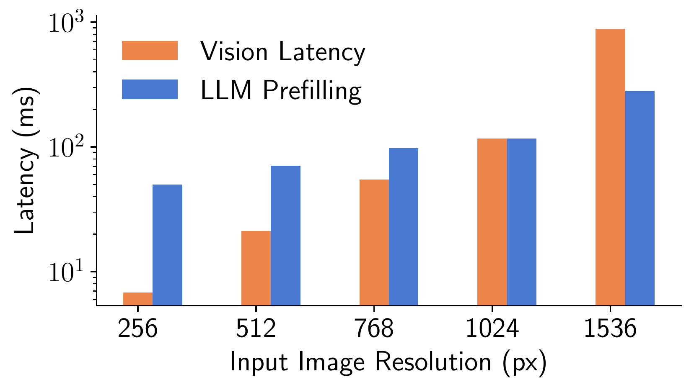
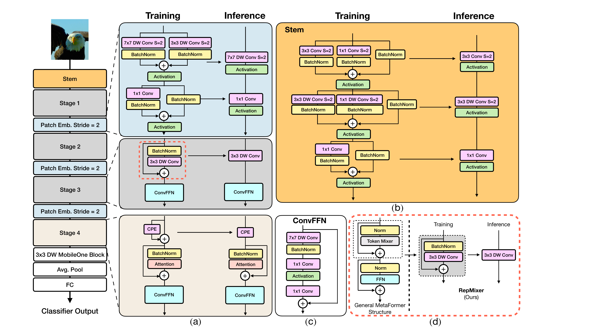
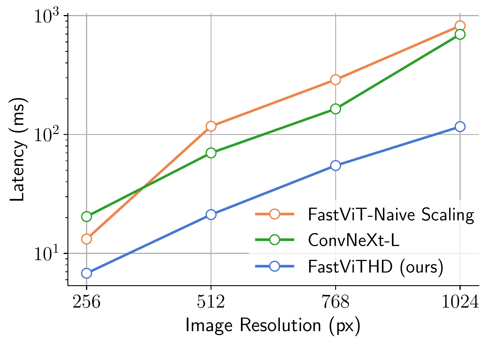
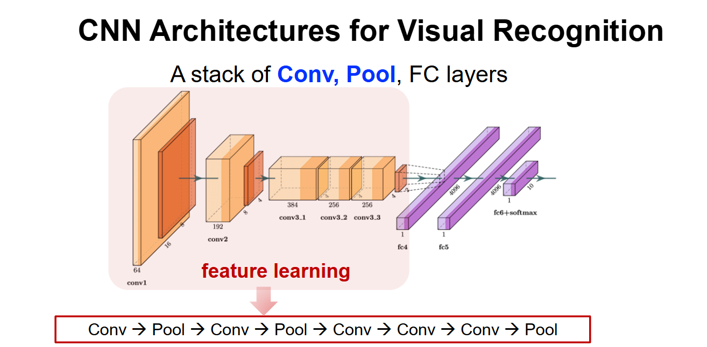
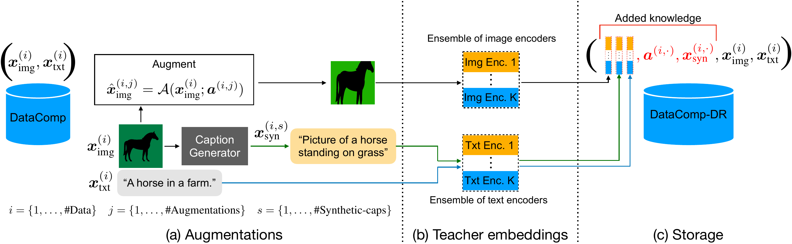
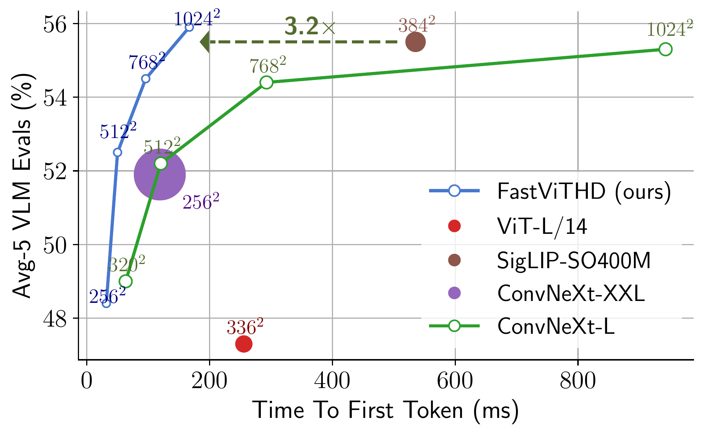
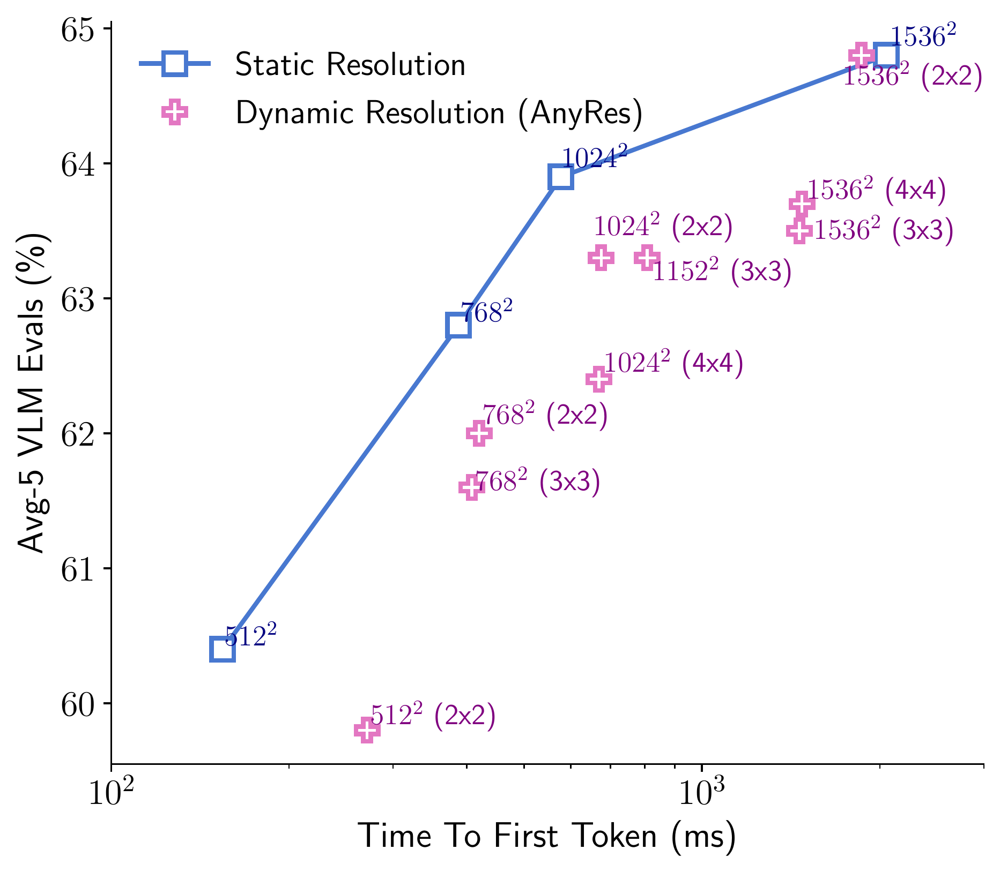
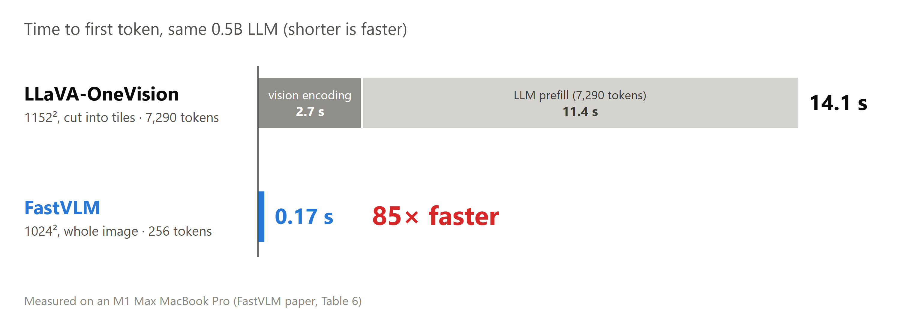

<!-- _class: lead -->
<!-- _paginate: false -->

# FastVLM

Redesigning the vision encoder for high resolution

CVPR 2025 · Apple

---

# Higher resolution, slower VLM

**TTFT = vision encoding time + LLM prefill time**

Token count grows with the **square** of resolution
More tokens → **both** parts get slower (e.g. self-attention: cost ∝ tokens²)

<!--
Say:
- TTFT, time to first token, is how long we wait before the model gives its first word. It has two parts: the vision encoder turns the image into tokens, then the LLM reads all of them (prefill).
- Higher resolution means more tokens: triple the side, nine times the tokens.
- More tokens slow down every module that processes them. Self-attention is the worst: every token looks at every other token, so its cost grows with the square of the token count. This hits both the encoder and the LLM.
-->

---

# Trimming tokens is not enough

- At high resolution, **vision encoding** takes most of TTFT
- Trimming tokens after the encoder only shortens **prefill**: the encoder still processes the whole image

→ Can we use an encoder **built for high resolution**?

<!--
Say:
- This chart splits TTFT into the two parts from the last slide. Note the y-axis is on a log scale.
- As resolution grows, the orange bar (encoding) catches up with the blue bar (prefill) and then overtakes it.
- Token-pruning methods leave the encoder as it is and trim tokens after it. At best that removes the blue bar; the orange bar stays, because the encoder has already processed the whole image.
- So the bottleneck is the encoder itself.
If asked: The chart is measured on the paper's own, already efficient encoder; a standard encoder would be even slower.
-->

---

# FastVLM swaps one box in the pipeline

- Only the vision encoder changes; projector and LLM follow LLaVA
- Every stage from here on lives **inside** this box

---

<!-- _class: center -->

# Predecessor FastViT: the big picture

Left: the skeleton, a 4-stage pyramid | Right: the parts inside each block

<!--
Say: Walk through the overall layout on the figure.
- The left column is the backbone: the stem downsamples 4×, then come 4 stages, with one more downsampling between each pair of stages.
- The first 3 stages use convolution (cheap, local view); the last one uses self-attention (expensive, global view).
- On the right, (a)–(d) show the inside of each block. Next we zoom in piece by piece: first the conv part, then where the design breaks down at high resolution.
-->

---

# The conv part is fine: one conv at inference

Training: several branches (easy to train) → Inference: merged into one conv (fast)
The bigger the image, the more it saves → **suits high resolution, keep as is**

<!--
Say: This is RepMixer's structural reparameterization. During training, y = conv(x) + x, with a skip branch; after training, since every operation is linear, it can be merged into one equivalent conv. The output is the same, but inference saves one round of memory reads and writes, which pays off most on large images.
Transition: The conv part is fine, so where is the problem? Look at the other two places.
-->

---

# Downsampled 32×: why is it still not enough?

- Each stage downsamples once; **every position left at the end is one token**
- 1024² image → 32×32 = **1024** tokens, still too many for the LLM

→ Can we **compress further**?

<!--
Animation: First show the stage column without labels (figures/zoomA_fastvit_stage_column.png) and explain the pyramid; then bring in the downsampling labels and the red box and explain why it is still not enough.
Say: Contrast with patchify: a ViT cuts the image into patches once and the token count never changes; a pyramid keeps shrinking the map as it computes.
-->

---

# Self-attention comes too early

To scale a model up, the usual move is stacking self-attention in stages 3 and 4

| Stage 3 (16× down) | Positions | Self-attention cost |
|---|---|---|
| 224² image | 196 | cheap |
| 1024² image | 4096 | about **400×** more |

<!--
Say: A four-step chain: we want a bigger model → the habit is to stack self-attention in stages 3 and 4 → those designs were made for small images → switch to large images and the cost explodes.
Transition: That is just on paper. How slow is it when it actually runs?
-->

---

<!-- _class: center -->

# In practice: scaled the usual way, slower than pure conv

Orange: usual scaling | Green: pure-conv ConvNeXt-L | Blue: FastViTHD (next slide)

<!--
Say:
- Note that the y-axis is on a log scale.
- The orange line is the approach from the last slide: stacking self-attention in stages 3 and 4. At high resolution it is slower than even the pure-conv green line.
- So the root cause is confirmed: not enough compression. Too little before self-attention, and compute explodes; too little before the LLM, and there are too many tokens.
- The blue line has the same parameter count as the orange one, yet it is much faster. How? Next slide.
-->

---

# Compress one more level

- Add a 5th stage: **64×** downsampling in total
- Move self-attention to the 32× and 64× stages

| ViT | FastViT | FastViTHD |
|---|---|---|
| ≈ 5300 | 1024 | **256** |

(tokens for a 1024² input)

<!--
Say: One change fixes both problems at once. This is the blue line from the last slide.
-->

---

# Why didn't anyone do this earlier?

- The harder you compress, the more area one token covers → **small text gets lost**
- The view at the time: ViTamin recommends only 16× downsampling in total

→ The real question: **how do we compress without losing information?**

---

# Compressing the right way

① Details first, then compress
Cheap convs (RepMixer) while the map is large; self-attention only once it is small

② Trade space for channels (next slide)

③ Multi-scale features (the slide after)

---

<!-- _class: center -->

# Remember this from class?

Each Conv / Pool step: the map gets **smaller**, the channels get **more** (64 → 192 → 384)

<!--
Say:
- Remember this CNN from class. The red box is the feature-learning part: conv and pool layers shrink the map step by step, while the number of channels grows.
- FastViTHD's stages are exactly this part. The FC layers for classification are not used: in a VLM, the final feature map goes to the projector and the LLM instead.
- Next: FastViTHD uses the same idea.
-->

---

<!-- _class: dense -->

# ② Trading space for channels

- Same pattern in FastViTHD: 5 stages, channels grow from 96 to 1536
- The final 16×16 = 256 positions each carry **1536** numbers: fewer tokens, each holding more

<!--
Say: Channels are not layers. Layers count how many operations are stacked (FastViTHD's five stages have 2, 12, 24, 4 and 2 layers); channels count how many numbers describe each position. An RGB image already has 3 channels. Each position in the last stage is one token, and it carries 1536 numbers.
-->

---

<!-- _class: dense -->

# ③ Multi-scale: what is the C?

1. Take one branch each from stages 2, 3 and 4
2. **Learned Pool**: a strided depthwise conv shrinks each to stage 5's size (16×16)
3. **C**: concatenate the branches along the **channel** dimension

→ Still **256** tokens, but each token now carries both coarse and fine information

<!--
Alternative figure: a crop of the paper's original figure, figures/fastvithd_multiscale_branches.png.
Say:
- Earlier stages have larger maps and see finer detail; the last stage is the most condensed and the most "semantic". Pulling the earlier stages in brings back detail lost during compression.
- Learned Pool vs. ordinary pooling: ordinary pooling just averages each small block; Learned Pool shrinks the map with a trainable conv. The paper tried both, and the learned one is slightly better.
- C (concatenation): at each position, the numbers from the branches are joined end to end, so the channel vector gets longer; the number of positions does not change, so neither does the token count.
- The projector then maps this long vector to the length the LLM can read.
-->

---

# Compression buys resolution

The same 256 tokens: for a VLM, **resolution is what matters**

<!--
Say: This is the same crop of the same image. Each red cell is one token, and on both sides the whole image is 16×16 = 256 tokens. On the left, 256 tokens only let a ViT see a 224² image, and the small text is already a blur; on the right, FastViTHD sees 1024², so both the table and the note are readable. The sample is fictional data we made ourselves.
-->

---

<!-- _class: center -->

# Cost ①: harder compression needs stronger training

Each token must hold more information → pretraining has to be stronger
Taken from their MobileCLIP: prepare **better captions** and **large teacher models' outputs** for every image-text pair

<!--
Say:
- This figure is the training-data pipeline from their earlier MobileCLIP, which FastViTHD reuses.
- (a) Augment each image, then have a captioning model write better captions;
- (b) have several very large CLIP models (the teachers) encode both the image and the text;
- (c) store all of this in the dataset, so the small model learns from the teachers' outputs during training, which is distillation.
- This is our reading: keeping its visual ability under such heavy compression very likely depends on this training.
-->

---

# Cost ②: resolution must match the LLM size

- A very small LLM **can't make use of** ultra-high-resolution images
- However well the vision side compresses, both ends still have to be tuned together

 

**Redesign the encoder from the inside, instead of patching it from the outside**

---

# Result ①: same accuracy, 3.2× faster

Same LLM and training; only the vision encoder changes

- Higher = more accurate (average of 5 benchmarks), further left = faster
- The blue line (FastViTHD) sits **up and to the left** of every other encoder
- Even at 1024², it is **3.2×** faster than SigLIP at 384², with the same accuracy

<!--
Say:
- This is the paper's Fig. 1. Every encoder is paired with the same 0.5B LLM and trained the same way, so only the encoder differs.
- The small labels are input resolutions. Follow the blue line: from 256² to 1024², accuracy keeps rising while the time stays under 0.2 s.
- SigLIP, a ViT-style encoder, needs about half a second just for 384². The 3.2× arrow is the paper's own.
-->

---

# Result ②: one whole image beats tiles

Same model (FastViTHD + 7B LLM), two ways to feed a large image:

- Blue squares: resize the **whole image**
- Pink crosses: cut it into **tiles** (2×2, 3×3, …)

At the same resolution, the whole image scores higher **and** runs faster; tiles only catch up at 1536²

<!--
Say:
- This answers the "image tiling" patch from the start of the talk. Note the x-axis is on a log scale.
- Compare points at the same resolution, for example 1024²: the blue square is higher and further left than every pink 1024² point.
- Tiling was a workaround for encoders that cannot take large images. FastViTHD can, so it does not need it; only at 1536² do 2×2 tiles draw level.
-->

---

# Result ③: vs. a tiling model with the same LLM

256 tokens instead of 7,290 → **85×** faster, with scores as good or better

<!--
Say:
- This is the paper's headline comparison. Both models use the same 0.5B LLM.
- LLaVA-OneVision cuts a 1152² image into tiles and ends up with 7,290 tokens, so most of its 14 seconds is the LLM reading tokens.
- FastVLM sends 256 tokens from one 1024² image: 0.17 s in total, and it still scores as well or better on SeedBench, MMMU and DocVQA.
-->

---

# Discussion

**What the results show**

- The speed-up comes from the encoder: same LLM, same training, only the encoder changed (Result ①)
- High resolution without tiling, few tokens without pruning (Results ② and ③)

**What to keep in mind**

- Speed was measured on one device (an M1 Max MacBook Pro); other hardware may gain differently
- In Result ③, FastVLM was trained on more data (27.5M vs. 7.7M samples), so not all of the gap is the encoder

→ **Fixing the encoder itself is what makes high resolution affordable**

<!--
Say:
- Two things the results support, and two to keep in mind.
- The cleanest evidence is Result ①, where the training is identical. Result ③ is the most striking number, but there the training data also differs (paper Table 6, rows R2 and R4).
- On the device: the paper runs the encoder on the Mac's neural engine and the LLM on its GPU, so the speed-up on a server GPU could be different.
-->
