

<!-- _class: lead -->
<!-- _paginate: false -->

# FastVLM

为高分辨率重新设计视觉编码器

CVPR 2025 · Apple

---

# 分辨率越高，VLM 越慢

**TTFT = 视觉编码时间 + LLM prefill 时间**

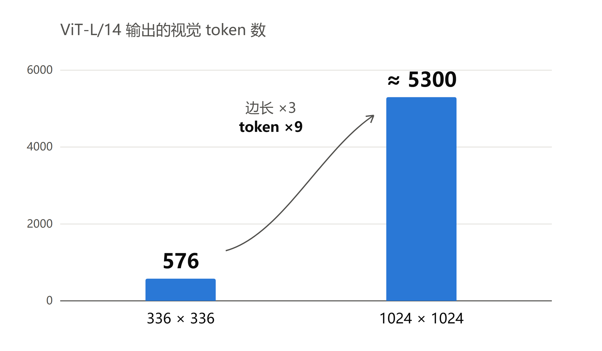

token 数随分辨率**平方**增长

<!--
讲：接前一位同学。ViT 从头到尾不降采样，图越大 token 越多，每层都要对所有 token 做自注意力。
-->

---

# 光减少 token 还不够

- 分辨率一高，**视觉编码本身**就是大头
- 剪枝、切图：都在 ViT 外面打补丁

→ 能不能换一个**天生适合高分辨率**的编码器？

<!--
讲：先说清楚这张图画的是论文自己的模型，token 已经很少了，编码时间还是占大头。所以只减 token 不够；切图编码次数更多，更糟。
-->

---

# FastVLM 只换了流水线里的一个框

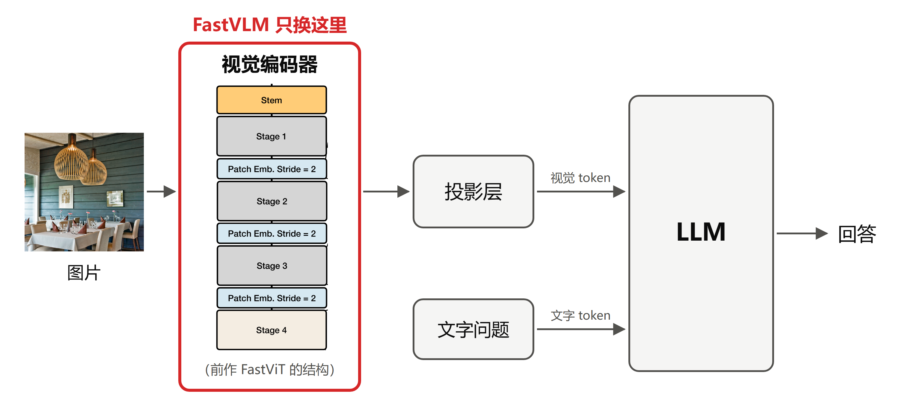

- 只换视觉编码器，投影层和 LLM 沿用 LLaVA
- 后面讲的 stage，都是这个框**里面**的结构

---

<!-- _class: center -->

# 前作 FastViT：整体框架

左边是骨架：4 个 stage 的金字塔 ｜ 右边是零件：每种模块的内部结构

<!--
讲：对着图讲大体框架。
- 左列是主干：stem 先缩小 4 倍，接 4 个 stage，stage 之间各缩小一次。
- 前 3 个 stage 用卷积（便宜，看局部），最后 1 个用自注意力（贵，看全局）。
- 右边 (a)～(d) 是各种模块的内部结构。接下来逐块放大：先看卷积部分，再看哪里不适合高分辨率。
-->

---

# 卷积部分没问题：推理时只剩一个卷积

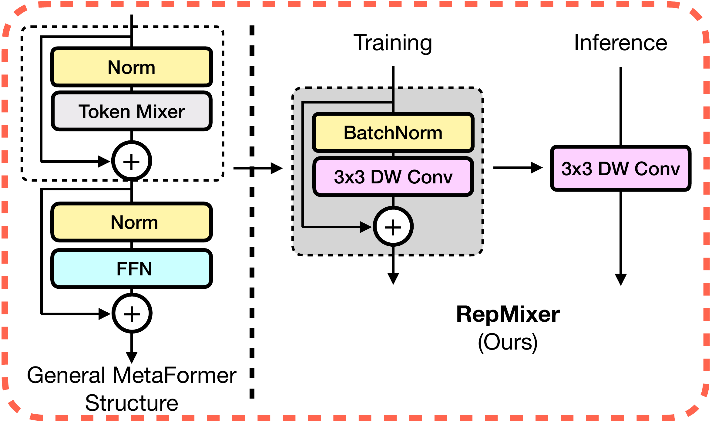

训练时多条支路（好训练）→ 推理时合成一个卷积（跑得快）
图越大，省得越多 → **这部分适合高分辨率，原样保留**

<!--
讲：这就是 RepMixer 的结构重参数化。训练时 y = 卷积(x) + x，有一条直通支路；训练完以后，因为都是线性运算，可以把它合并成一个等价的新卷积。计算结果一样，但推理时少了一次来回读写，大图上省得尤其多。
过渡：卷积部分没问题，那问题出在哪？看另外两处。
-->

---

# 压了 32 倍，为什么还不够？

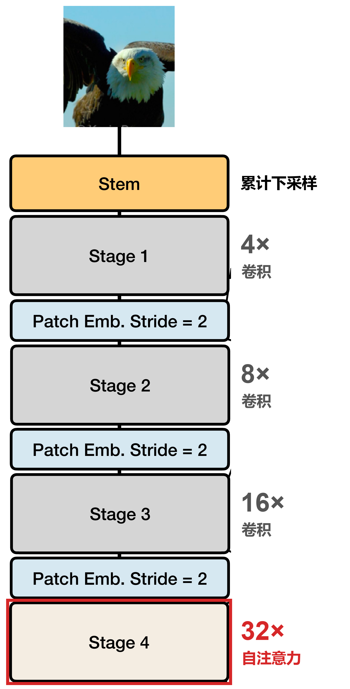

- 每过一个 stage 缩小一次，**最后剩几个位置，就是几个 token**
- 1024² 的图 → 32×32 = **1024** 个 token，交给 LLM 还是太多

→ 能不能**再压**？

<!--
动画：先放不带标注的 stage 列（figures/zoomA_fastvit_stage_column.png），讲金字塔；再出倍数标注和红框，讲为什么还不够。
讲：和切块对比，ViT 一开始切好、token 数不变；金字塔一边算一边缩小。
-->

---

# 自注意力放得太早

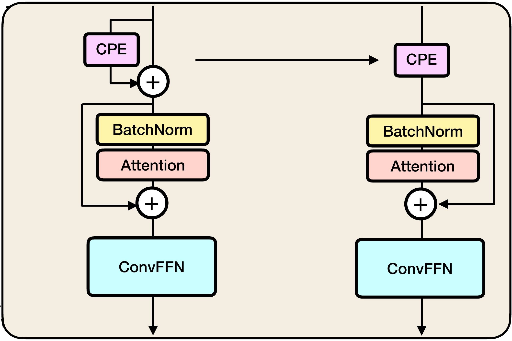

模型放大时，习惯在 stage 3、4 多堆自注意力

| stage 3（压 16 倍） | 位置数 | 自注意力开销 |
|---|---|---|
| 224² 小图 | 196 | 便宜 |
| 1024² 大图 | 4096 | 贵约 **400 倍** |

<!--
讲：四步链：想把模型放大 → 习惯在 stage 3、4 堆自注意力 → 这些设计原本面向小图 → 换成大图，开销爆炸。
过渡：这只是算出来的，实际跑起来有多慢？
-->

---

<!-- _class: center -->

# 实际跑起来：照常规放大，比纯卷积还慢

橙：照常规放大的 FastViT ｜ 绿：纯卷积 ConvNeXt-L ｜ 蓝：FastViTHD（下一页讲）

<!--
讲：
- 注意纵轴是对数坐标。
- 橙线就是上一页说的做法：在 stage 3、4 堆自注意力。分辨率一高，它比纯卷积的绿线还慢。
- 所以病根确认了：压得不够。做自注意力之前压得不够，计算爆炸；交给 LLM 之前压得不够，token 太多。
- 蓝线和橙线参数量一样，却快得多。它是怎么做到的？下一页。
-->

---

# 再压一层

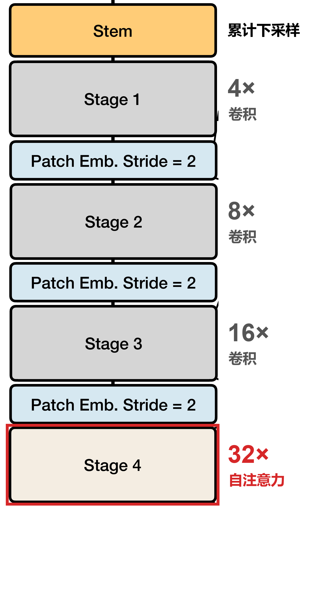
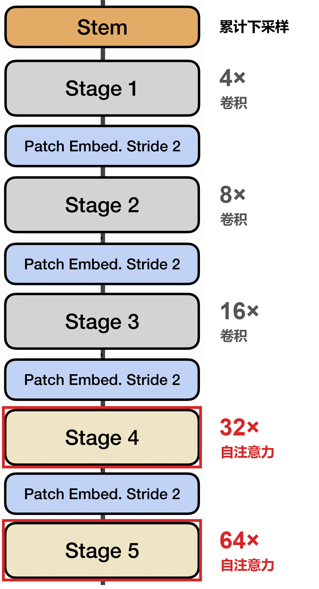

- 加第 5 个 stage，总共压 **64 倍**
- 自注意力挪到 32×、64× 处

| ViT | FastViT | FastViTHD |
|---|---|---|
| ≈ 5300 | 1024 | **256** |

（1024² 输入的 token 数）

<!--
讲：一个改动同时治好两个问题，也就是上一页的蓝线。
-->

---

# 为什么别人没早这么做？

- 压得越狠，一个 token 盖住的区域越大 → **小字容易丢**
- 当时的主流看法：ViTamin 建议总共只压 16 倍

→ 真正的问题：**怎么压，才能不丢东西？**

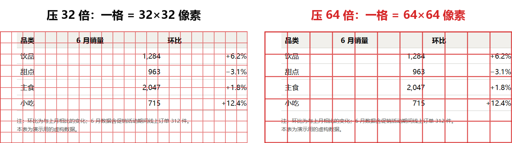

---

# 怎么压到点上

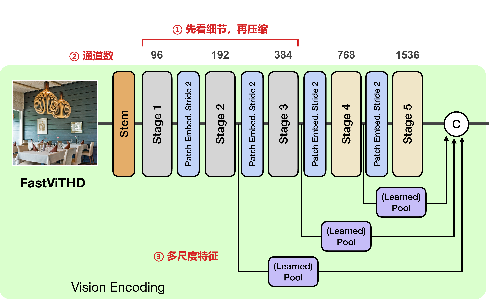

① 先看细节，再压缩
图大时用便宜的卷积（RepMixer），压小了才做自注意力

② 空间换通道（下一页）

③ 多尺度特征（再下一页）

---

<!-- _class: dense -->

# ② 空间换通道：什么是“通道”？

- 特征图 = 高 × 宽 × **通道**
- 一个卷积核卷出一个通道，几个核就有几个通道 → 每个位置有**几种特征**

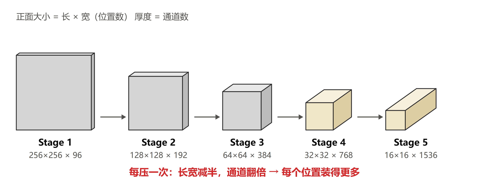

<!--
讲：通道不是层数。层数是叠了多少次运算（FastViTHD 五个 stage 分别是 2、12、24、4、2 层）；通道是每个位置用几个数来描述。RGB 图本身就是 3 个通道。最后一个 stage 的每个位置就是一个 token，它带着 1536 个数。
-->

---

<!-- _class: dense -->

# ③ 多尺度特征：图里的 C 是什么？

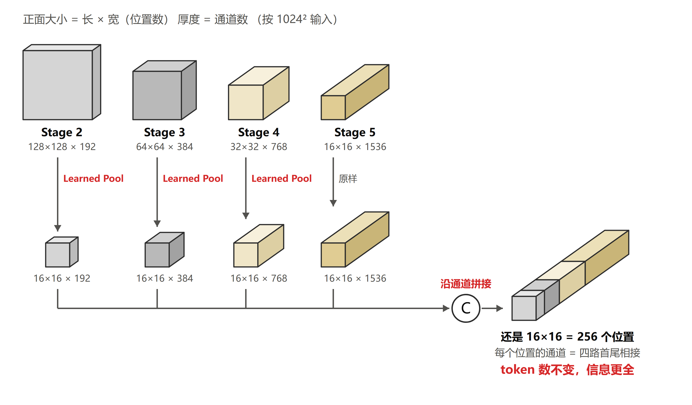

1. 从 stage 2、3、4 各引出一路特征
2. **Learned Pool**：用带步长的深度卷积，缩到和 stage 5 一样大（16×16）
3. **C**：把几路特征沿**通道方向**拼起来

→ token 数还是 **256**，但每个 token 同时带着粗、细两种信息

<!--
备选配图：论文原图局部 figures/fastvithd_multiscale_branches.png。
讲：
- 越靠前的 stage，图越大、看得越细；最后一个 stage 最浓缩、最“懂语义”。把前面的拉过来，能补回压缩时丢的细节。
- Learned Pool 和普通池化的区别：普通池化是对每个小块直接取平均；Learned 是用一个能学习的卷积来缩小。论文两种都试了，后者稍好。
- C（拼接）：同一个位置上，几路特征的数字首尾接起来，通道变长；位置数没变，所以 token 数不变。
- 之后投影层再把这个长向量映射成 LLM 能读的长度。
-->

---

# 压缩换来的是分辨率

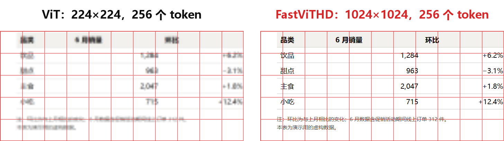

同样 256 个 token，对 VLM 来说，**分辨率才是关键**

<!--
讲：这是同一张图的同一块局部，红格一格就是一个 token，整张图两边都是 16×16 = 256 个 token。左边是 ViT 用 256 个 token 只能看的 224² 图，小字已经糊掉；右边 FastViTHD 能看 1024²，表格和注释都读得出来。示例图是我们自己做的虚构数据。
-->

---

<!-- _class: center -->

# 代价①：压得狠，就需要更强的训练

每个 token 要装更多信息 → 预训练必须更强
做法来自他们的 MobileCLIP：给每对图文提前备好**更好的配文**和**大模型老师的答案**

<!--
讲：
- 这张图是他们前作 MobileCLIP 的训练数据准备流程，FastViTHD 沿用了它。
- (a) 给每张图做增强，再用一个会写描述的模型补写更好的配文；
- (b) 让几个很大的 CLIP 模型（老师）把图和文各算一遍；
- (c) 把这些都存进数据集，小模型训练时照着老师的答案学，也就是蒸馏。
- 这是我们的理解：压得这么狠还能保住看图能力，很可能离不开这套训练。
-->

---

# 代价②：分辨率要和 LLM 大小匹配

- 给很小的 LLM 喂超高分辨率的图，它也**用不上**
- 视觉端压得再好，整个系统还是要两头一起调

 

**从编码器内部重新设计，而不是在外面打补丁**
