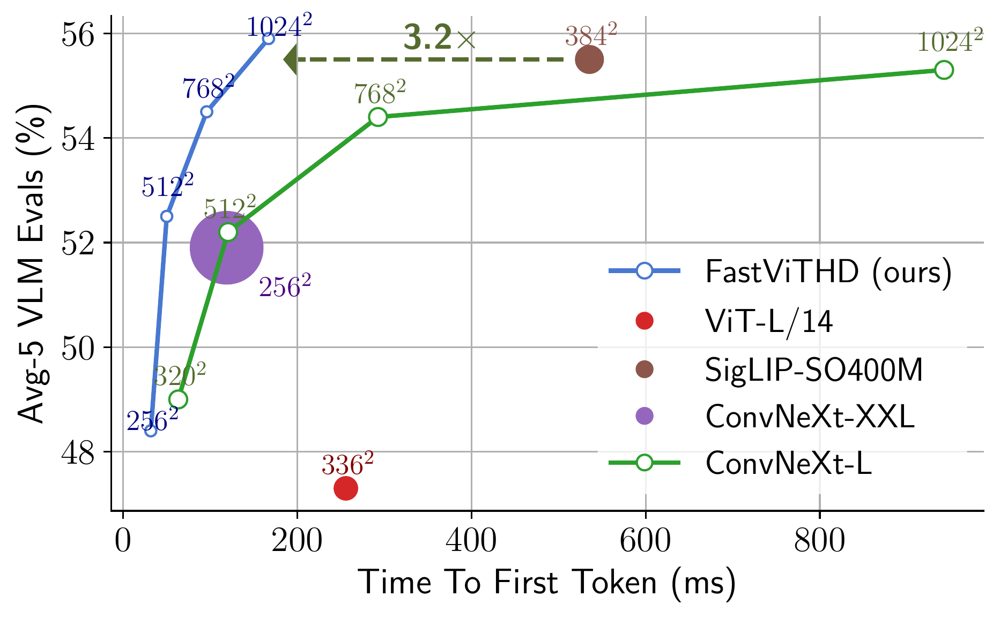
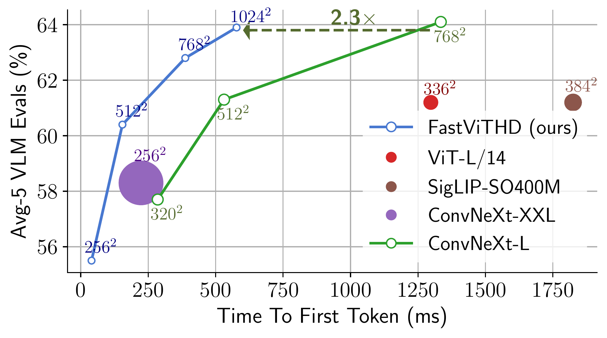
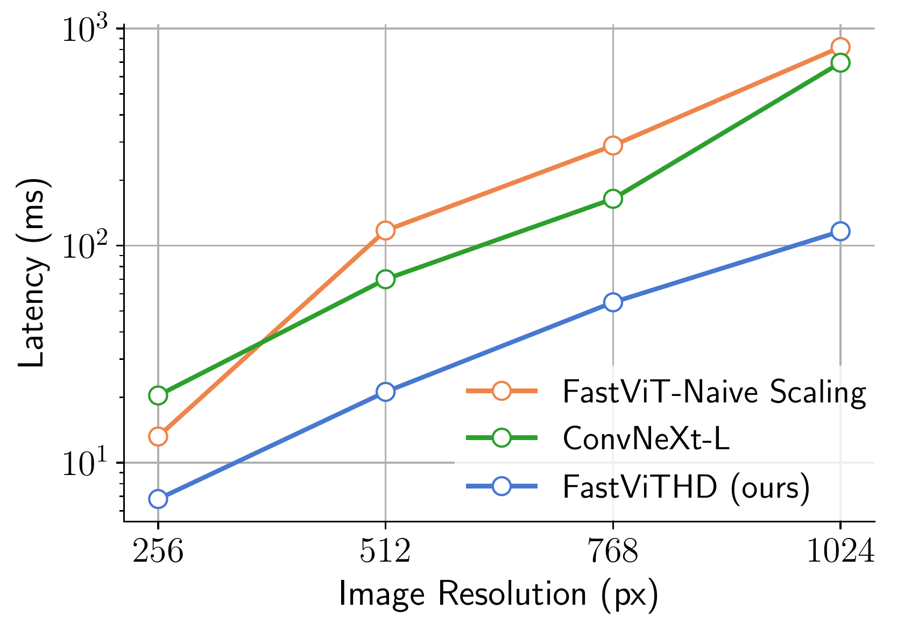
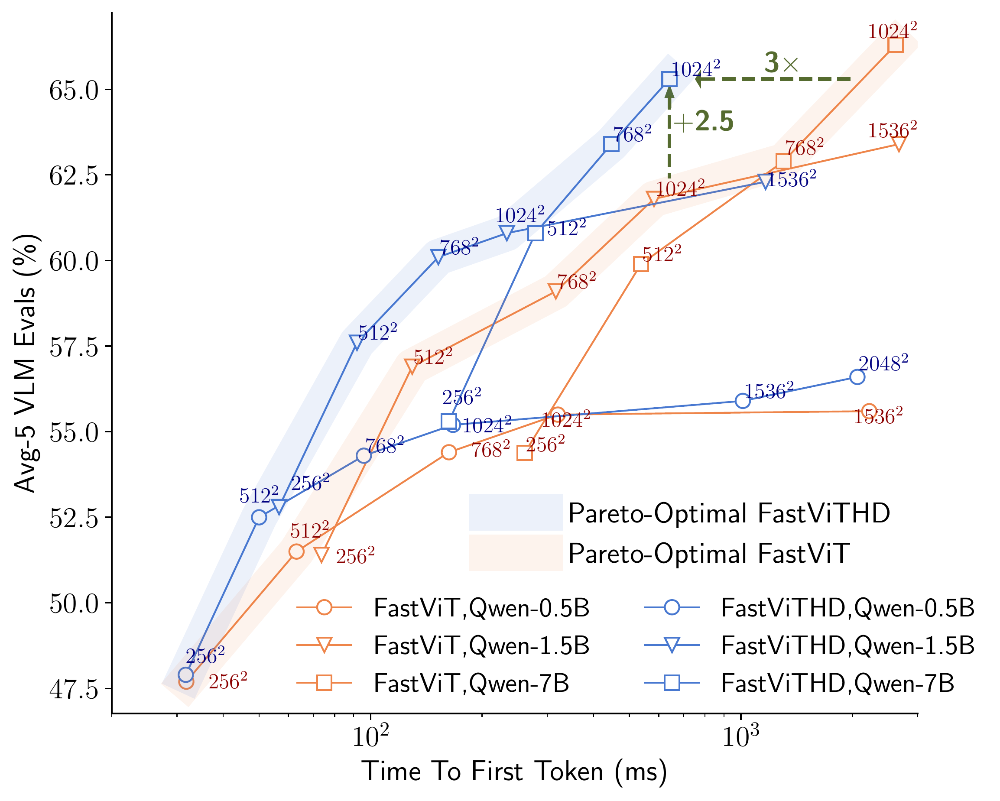
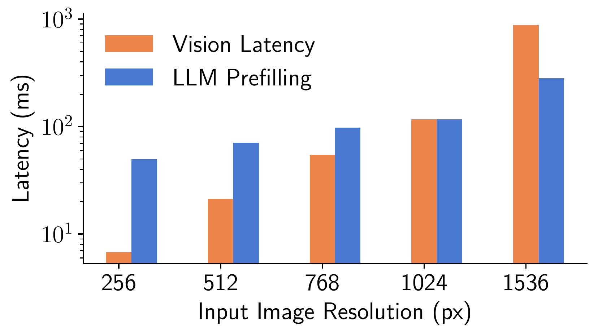
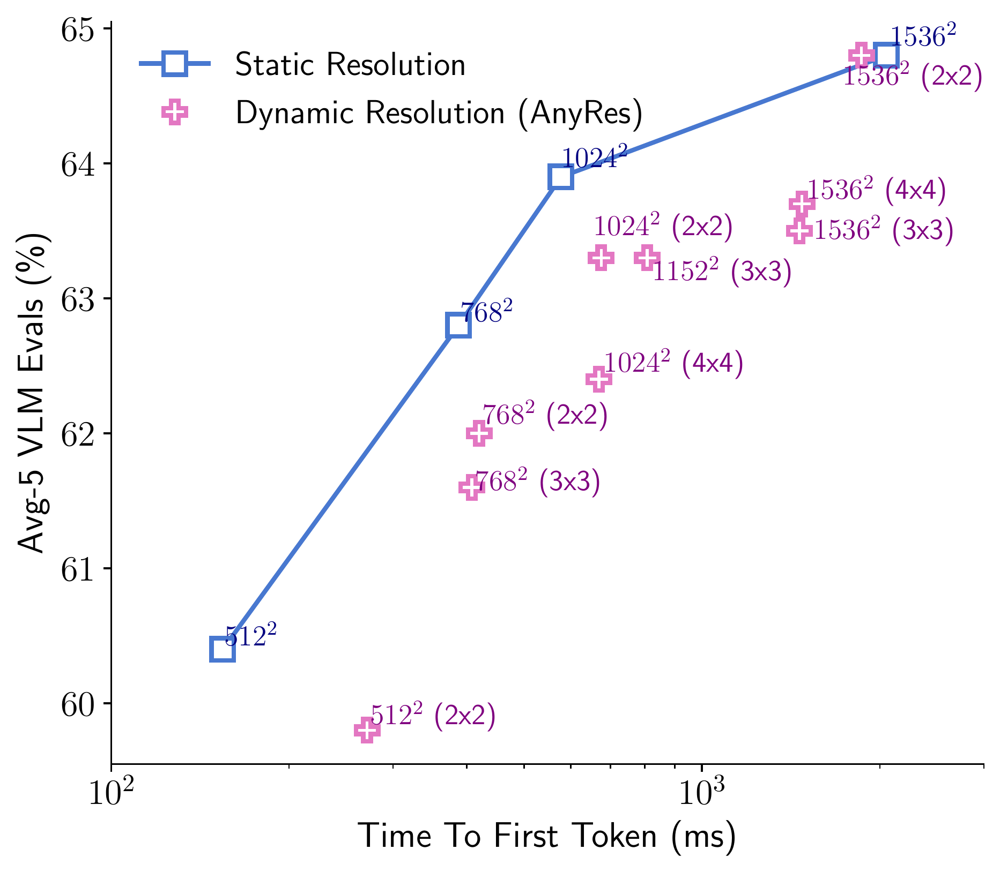

# FastVLM: Efficient Vision Encoding for Vision Language Models — 文献深度精读

- **论文标题**：*FastVLM: Efficient Vision Encoding for Vision Language Models*
- **作者与机构**：Pavan Kumar Anasosalu Vasu\*,†, Fartash Faghri\*, Chun-Liang Li\*, Cem Koc\*, Nate True, Albert Antony, Gokul Santhanam, James Gabriel, Peter Grasch, Oncel Tuzel\*, Hadi Pouransari\*,†（Apple）
- **发表会议 / 版本**：CVPR 2025（arXiv: [`2412.13303v2`](https://arxiv.org/abs/2412.13303)，2025 年 5 月更新）
- **开源代码与模型**：[`https://github.com/apple/ml-fastvlm`](https://github.com/apple/ml-fastvlm)
- **本地原文 PDF**：[`../paper/FastVLM_2412.13303.pdf`](../paper/FastVLM_2412.13303.pdf)

---

## 1. 一句话核心总结（TL;DR）

针对视觉语言模型（VLM）在高分辨率图像下**视觉编码延迟高**且**视觉 Token 数量爆炸导致 LLM 预填充（Prefill）极慢**的双重瓶颈，Apple 提出了专为高分辨率 VLM 设计的 **5 阶段卷积-Transformer 混合视觉编码器 `FastViTHD`**（总下采样率 $64\times$，相比 ViT-L/14 减少 $16\times$ 视觉 Token），构建了 **`FastVLM`**。**无需任何后验 Token 剪枝或复杂分块（Tiling）**，仅靠原生缩放输入分辨率即可在精度与首字延迟（TTFT）之间达到帕累托最优（Pareto-optimal）：在 LLaVA-1.5 设定下实现 **$3.2\times$ TTFT 加速**；在 0.5B 规模下相比最高分辨率的 LLaVA-OneVision 实现 **$85\times$ TTFT 加速**（166 ms vs. 14,124 ms）且视觉编码器体积缩小 **$3.4\times$**。

> **图 1（论文 Fig. 1）**：在相同 LLaVA-1.5 训练流程与真实端侧硬件（M1 Max MacBook Pro）测试下，`FastViTHD` 配合 Qwen2-0.5B（上）或 Vicuna-7B（下）在「5 项主流 VLM 基准平均分（Avg-5）vs. 首字延迟（TTFT）」上全面领先 ViT-L/14、SigLIP-SO400M 和 ConvNeXt-L/XXL，实现 **$>3\times$ 端到端首字加速**。圆点面积代表视觉编码器参数量。

---

## 2. 研究背景与核心痛点（Motivation）

### 2.1 现代自回归 VLM 的标准范式与延迟构成
主流自回归 VLM（如 LLaVA、Qwen-VL、InternVL 等）由三大组件串联构成：
1. **视觉编码器（Vision Backbone）**：将输入图像 $I \in \mathbb{R}^{H \times W \times 3}$ 编码为 $N_v$ 个视觉特征向量（Visual Tokens）。
2. **视觉-语言投影层（Connector / Projector）**：通常为 MLP，将视觉 Token 映射到 LLM 的词嵌入空间。
3. **大语言模型解码器（LLM Decoder）**：将视觉 Token 与文本指令 Token 拼接后自回归生成回答。

在实际交互体验中，决定用户感知响应速度的核心指标是 **首字延迟（Time-To-First-Token, TTFT）**：
$$\text{TTFT} = T_{\text{vision\_encoder}}(R) + T_{\text{LLM\_prefill}}(N_v, M_{\text{LLM}})$$
其中 $R$ 为输入图像分辨率，$N_v$ 为视觉编码器输出的 Token 数量，$M_{\text{LLM}}$ 为 LLM 的参数规模。

### 2.2 高分辨率输入的必要性与两大效率瓶颈
大量研究表明，**提高输入图像分辨率是提升 VLM 性能（尤其是文档理解 DocVQA、场景文字识别 TextVQA、图表问答 ChartQA 等富文本/细粒度任务）最关键的因素**。然而，以 ViT（如 ViT-L/14、SigLIP-SO400M）为代表的各向同性（Isotropic）视觉编码器在高分辨率下面临两大算力困境：

1. **视觉编码器自身延迟激增（$T_{\text{vision\_encoder}}$ 高）**：
   - 无论是直接将 ViT 微调到高分辨率（全局自注意力复杂度随 Patch 数量呈二次方 $O(N_v^2)$ 增长），还是采用分块策略（Tiling / AnyRes，如 LLaVA-NeXT、LLaVA-OneVision 将大图切分为多个子图分别编码），都会导致极高的视觉编码耗时。
   - **论文关键发现（Fig. 5）**：当分辨率提升到 $768\times 768$ 及以上时，**视觉编码器的延迟甚至会反超 LLM Prefill 延迟，成为 TTFT 的主导瓶颈**。
2. **视觉 Token 数量爆炸拖慢 LLM 预填充（$N_v$ 大 $\rightarrow T_{\text{LLM\_prefill}}$ 高）**：
   - ViT-L/14 在 $336\times 336$ 分辨率下输出 $(336/14)^2 = 576$ 个 Token；而在 $1024\times 1024$ 下会输出超过 $5300$ 个 Token。
   - 采用 AnyRes 动态分块的 LLaVA-OneVision 在 $1152\times 1152$ 分辨率下输出的视觉 Token 高达 **7,290 个**，在 M1 Max 上仅 LLM Prefill 就需要 **11.4 秒**（总 TTFT 高达 14.1 秒）！

### 2.3 现有改进方案的局限性
- **路线 A：在 ViT 输出端做后验 Token 剪枝/合并（Token Pruning / Resampling）**
  - 代表工作：LLaVA-PruMerge、Matryoshka (M3 / MQT)、FastV、SparseVLM、VisionZip、DynamicLLaVA 等。
  - **缺陷**：一方面，它们**无法降低视觉编码器本身的推理延迟**（仍需先跑完笨重的 ViT 生成全部 Token，再做剪枝）；另一方面，后验丢弃 Token 会损失细粒度空间信息，精度不如原生输出少量高质量 Token 的层级化骨干网络（见论文 Table 5）。
- **路线 B：使用纯卷积网络或常规 4 阶段混合骨干（ConvNeXt / FastViT / ViTamin）**
  - 代表工作：ConvLLaVA（使用 ConvNeXt）、ViTamin。
  - **缺陷**：纯卷积网络（如 ConvNeXt-XXL）需要堆叠极大参数量（846M）才能赶上 VLM 精度，高分辨率下依然缓慢；而常规 4 阶段卷积-Transformer 混合架构（如 FastViT、ViTamin）在第 3、4 阶段（仅 $16\times$ 下采样）堆叠自注意力层，当分辨率放大到 $768^2 \sim 1024^2$ 时，自注意力张量依然过大，延迟随分辨率急剧恶化（见论文 Fig. 3）。

---

## 3. 核心方法与架构设计（Methodology & Architecture）

论文通过「两步走」完成了从基础混合架构验证到专用高分辨率编码器 `FastViTHD` 的演进：

> **图 2（论文 Fig. 2）**：`FastVLM` 与 `FastViTHD` 整体架构图。`FastViTHD` 采用 5 阶段层级化混合设计（前 3 个阶段使用轻量级卷积 `RepMixer`，后 2 个阶段在 $32\times$ 与 $64\times$ 下采样特征图上执行多头自注意力 `MHSA`），并结合多尺度特征深度可分离卷积池化（Learned Pool + Channel Concatenation），生成比 FastViT 少 $4\times$、比 ViT-L/14 少 $16\times$ 的视觉 Token。

### 3.1 第一步：验证混合视觉骨干（FastViT）与多尺度特征融合（Sec. 3.1）

1. **为什么混合架构（Hybrid Conv-Transformer）天然适合 VLM？**
   - **前端卷积层**支持高效的原生高分辨率扩展，并通过逐阶段空间下采样（Downsampling）大幅压缩 Token 数量；
   - **后端 Transformer 自注意力块**负责全局上下文建模，提炼高质量、语义对齐的视觉 Token 供 LLM 消费。
2. **初步实验验证（Table 1）**：
   - 作者首先将 MobileCLIP 预训练的 `FastViT`（MCi2 变体，仅 35.7M 参数，总下采样率 $32\times$）接入 LLaVA-1.5（Vicuna-7B）。
   - 在预训练分辨率 $256\times 256$ 下，FastViT 仅输出 $(256/32)^2 = 64$ 个 Token，虽然编码仅需 3.0 ms，但分辨率过低导致 VLM 精度不足（Avg-5 为 54.4%）。
   - 当将输入分辨率直接放大到 **$768\times 768$**（Stage-2 放开视觉编码器微调）时，FastViT 输出 $(768/32)^2 = 576$ 个 Token（与 ViT-L/14 @ $336\times 336$ 的 Token 数完全相同），但：
     - **编码延迟降低近 $4\times$**：34.5 ms vs. 127.4 ms；
     - **VLM 综合精度反超**：Avg-5 达到 **62.6%**（超越微调版 ViT-L/14 的 61.2%），在富文本任务上提升尤为显著（TextVQA: 62.3 vs. 59.2，DocVQA: 34.4 vs. 28.7）。
3. **多尺度特征聚合（Multi-Scale Features，Sec. 3.1.1 & Table 2）**：
   - 层级化骨干通常分为多个下采样阶段（Stages）。常规 VLM 只取倒数第二层的高层语义特征，容易丢失早期阶段的细粒度空间信息（如小字号文本、表格线条）。
   - **改进设计**：如图 2 所示，从不同阶段提取特征，经过可学习的池化层（Learned Pool）对齐到最后阶段的空间尺寸，再沿通道维度拼接（`C`）后送入 Connector。
   - **消融结论（Table 2）**：使用 **2D 深度可分离卷积（DWConv）** 作为池化算子优于普通平均池化（AvgPool），将 FastViT 的 Avg-5 进一步从 62.6% 提升至 **62.9%**。

---

### 3.2 第二步：设计高分辨率专用混合编码器 `FastViTHD`（Sec. 3.2）

虽然 35.7M 的 FastViT 展现出优异潜力，但先验研究表明适当扩大视觉编码器容量能显著增强泛化能力。问题在于：**如何正确地放大（Scale up）混合视觉编码器？**

> **图 3（论文 Fig. 3）**：不同图像分辨率下的视觉编码延迟对比（对数坐标）。如果按照传统 4 阶段混合模型的方式直接在第 3、4 阶段增加自注意力层数和通道宽度（`FastViT-Naive Scaling`），高分辨率下的延迟甚至比纯卷积网络 `ConvNeXt-L` 还要慢；而本文提出的 5 阶段 `FastViTHD` 在相同参数量下将全分辨率区间的延迟降低了数倍。

#### （1）朴素放大的缺陷（FastViT-Naive Scaling）
传统 4 阶段混合架构（如 MOAT、ViTamin）总下采样率为 $16\times$ 或 $32\times$，且在第 3 阶段（下采样 $16\times$）堆叠大量自注意力层。如论文附录 B.1 所示，若将 4 阶段 FastViT 放大到约 125M 参数（各阶段深度 `[2, 12, 16, 6]`，维度 `[128, 256, 512, 1024]`），高分辨率图像在第 3 阶段产生的 Token 依然过多，导致自注意力计算成为严重瓶颈（图 3 红线）。

#### （2）`FastViTHD` 的核心架构创新：5 阶段设计 + $64\times$ 总下采样
为了彻底消除高分辨率下的自注意力算力爆炸，作者设计了 **`FastViTHD`**（图 2 左侧）：
1. **引入第 5 阶段与额外下采样层（总下采样率 $64\times$）**：
   - **Convolutional Stem**：对输入图像在长宽方向各做 $4\times$ 下采样。
   - **4 个 Patch Embedding 下采样层**（位于 Stage 1$\rightarrow$2、2$\rightarrow$3、3$\rightarrow$4、4$\rightarrow$5 之间）：每层采用 stride=2 的 $7\times 7$ 深度可分离卷积（带 MobileOne 风格的重参数化分支）接 $1\times 1$ 逐点卷积，每次下采样 $2\times$。
   - **移除 Squeeze-and-Excitation (SE) 模块**：附录 B 指出，MobileCLIP 原有的 SE 模块在高分辨率推理时会带来显著的端侧延迟开销，因此 `FastViTHD` 将其移除。
   - **空间下采样倍数演进**：
     $$\text{Stem (4}\times\text{)} \xrightarrow{\text{Stage 1}} 4\times \xrightarrow{\text{Stage 2}} 8\times \xrightarrow{\text{Stage 3}} 16\times \xrightarrow{\text{Stage 4}} 32\times \xrightarrow{\text{Stage 5}} \mathbf{64\times}$$
2. **前 3 阶段卷积 + 后 2 阶段自注意力的黄金切分**：
   - **Stage 1 ~ Stage 3（高分辨率特征图）**：全部采用结构重参数化卷积模块 **`RepMixer`**（推理时等价为单一深度卷积，无自注意力二次方开销）。
   - **Stage 4 ~ Stage 5（高度浓缩特征图）**：仅在空间尺寸已被下采样 **$32\times$**（Stage 4）和 **$64\times$**（Stage 5）的特征张量上执行 **多头自注意力（MHSA）**！
3. **具体配置参数**：
   - **各阶段层数（Depth）**：`[2, 12, 24, 4, 2]`（共 44 层，计算主力集中在 Stage 2/3 的 RepMixer 和 Stage 4/5 的高维紧凑 MHSA）。
   - **各阶段通道维度（Embedding Dim）**：`[96, 192, 384, 768, 1536]`（逐阶段翻倍）。
   - **ConvFFN 扩展比（MLP Expansion Ratio）**：$4.0$（每个 FFN 前置一个 $7\times 7$ 深度卷积）。
   - **总参数量**：**125.1M**（是 FastViT-MCi2 的 $3.5\times$，但比 ViT-L/14 的 304M 小 $2.4\times$，比 SigLIP-SO400M 的 430M 小 $3.4\times$）。
4. **极具优势的视觉 Token 数量缩放规律**：
   对于输入分辨率 $R \times R$，`FastViTHD` 输出的视觉 Token 数为：
   $$N_v = \left(\frac{R}{64}\right)^2$$
   - $R = 256 \implies N_v = \mathbf{16}$ 个 Token
   - $R = 512 \implies N_v = \mathbf{64}$ 个 Token
   - $R = 768 \implies N_v = \mathbf{144}$ 个 Token
   - $R = 1024 \implies N_v = \mathbf{256}$ 个 Token
   - $R = 1536 \implies N_v = \mathbf{576}$ 个 Token（直到 $1536\times 1536$ 超高分辨率，其 Token 数才相当于 ViT-L/14 在 $336\times 336$ 下的数量！）

#### （3）`FastViTHD` 的 CLIP 预训练与基础能力验证（Table 3 & Table 4）
- **预训练方案**：遵循 MobileCLIP 的多模态强化训练（Multi-Modal Reinforced Training）流程，在 **DataCompDR-1B** 数据集（含合成密集描述与教师模型蒸馏）上从头预训练 `FastViTHD`。
- **CLIP 零样本评测结果（Table 3）**：在 38 项多模态零样本基准上，`FastViTHD`（125M，延迟 6.8 ms）取得了 **66.3%** 的平均分，与 ViT-L/14（304M，延迟 47.2 ms，66.3%）持平，且平均图文检索性能高达 **67.7%**（远超 ViT-L/14 的 60.8% 和 ViTamin-L 的 60.3%），同时**参数量小 $2.4\times \sim 2.7\times$，编码速度快 $5.6\times \sim 6.9\times$**。
- **对比同为层级化编码器的 ConvNeXt（Table 4）**：在控制输出相同视觉 Token 数（64 或 256 个 Token）的条件下，`FastViTHD` 能够以更高的输入分辨率（如 $1024^2$ vs. ConvNeXt-XXL 的 $512^2$）运行，不仅 VLM 精度全面追平甚至超越 846M 的 ConvNeXt-XXL，而且**模型体积小 $6.8\times$，编码速度快 $3.3\times$**。

---

## 4. 系统级效率分析：分辨率、Token 数与 LLM 规模的博弈（Sec. 3.2.1 – 3.2.3）

论文第 3.2 节后半部分提供了一套极具启发性的 **VLM 运行时效率分析框架**，解答了三个核心工程与科学问题：

### 4.1 视觉编码器与语言解码器的协同博弈（Vision-Language Interplay）

> **图 4（论文 Fig. 4，上）与 图 5（论文 Fig. 5，下）**：
> - **上图（Fig. 4）**：将 `FastViT` 与 `FastViTHD` 分别搭配 Qwen2-0.5B / 1.5B / 7B 三种尺寸的 LLM，并在 $256^2 \sim 2048^2$ 多种分辨率下完成 LLaVA-1.5 训练，绘制出「Avg-5 精度 vs. TTFT」的散点与**帕累托最优前沿（Pareto-Optimal Curve）**。
> - **下图（Fig. 5）**：在 `FastViTHD` + Qwen2-1.5B 下，随着输入分辨率从 $256^2$ 增至 $1536^2$，TTFT 中视觉编码延迟（橙色）与 LLM Prefill 延迟（蓝色）的占比变化。

从这两组实验中可以得出三条重要定律：
1. **高分辨率下视觉编码延迟占主导（Fig. 5）**：由于 `FastViTHD` 将视觉 Token 压缩了 $64^2 = 4096$ 倍，LLM Prefill 时间增长平缓；而在 $768^2$ 以上高分辨率区域，视觉编码耗时占到了总 TTFT 的绝大部分。这证明了优化高分辨率视觉编码器本身（而非仅减少 Token）的必要性。
2. **「高分辨率 + 小 LLM」是次优组合（Fig. 4）**：在给定 TTFT 预算下，帕累托最优曲线是由不同尺寸的 LLM 共同接力构成的。如果给一个很小的 LLM（如 Qwen2-0.5B）输入极高分辨率（如 $1536^2$），小 LLM 的推理容量无法有效利用如此丰富的视觉特征（精度饱和），同时却要承受高昂的视觉编码延迟，因此偏离帕累托前沿。
3. **`FastViTHD` 全面推高帕累托边界（Fig. 4）**：在任意给定的延迟预算（TTFT）下，遍览所有 `(Resolution, LLM)` 组合，`FastViTHD` 的帕累托前沿比 `FastViT` **平均高出 $>2.5$ 个百分点**；或者在达到相同目标精度时，**推理速度快达 $3\times$**。

---

### 4.2 静态直接缩放（Static Resolution）vs. 动态分块（Dynamic Tiling / AnyRes）

> **图 6（论文 Fig. 6）**：在 `FastViTHD` + Vicuna-7B 下，直接调整编码器输入分辨率（Static Resolution，蓝线）与采用 AnyRes 动态切图分块（Dynamic Resolution，粉圈，括号内为网格尺寸如 $2\times 2, 3\times 3, 4\times 4$）的精度-延迟对比。

- **核心结论**：
  1. **直接静态缩放分辨率（Static Resolution）几乎在所有常规分辨率（$512^2 \sim 1536^2$）下都是帕累托最优的！**
  2. **原因分析**：分块策略（AnyRes）原本是为无法直接处理大图的 ViT 设计的妥协方案，但将图像切碎成多块（如 $3\times 3$ 或 $4\times 4$）会引入人为的**语义割裂（Semantic Breaks）**，导致在相同有效分辨率下精度反而低于整图直接编码，且延迟更高。
  3. **何时才需要 AnyRes？** 仅当分辨率推高到极端水平（如 $1536\times 1536$ 或 $2048\times 2048$），单张整图推理受限于硬件内存带宽（Memory Bandwidth）时，采用**大尺寸少分块（$2\times 2$ 网格，单块 $1024\times 1024$，峰值分辨率 $2048\times 2048$）**才具有优势（相比 InternVL2 切分多达 36 个小块的做法更加高效且语义完整）。

---

### 4.3 原生分辨率缩放 vs. 视觉 Token 剪枝算法（Sec. 3.2.3 & Table 5）

- 论文在相同 LLaVA-1.5 (Vicuna-7B) 设定下，将 `FastViTHD` 在不同分辨率下的表现与近年来最先进的 **ViT Token 剪枝/稀疏化方法**（Matryoshka $M^3$、MQT、PruMerge/PruMerge+、FastV、SparseVLM、VisionZip、DynamicLLaVA）按相同视觉 Token 数分组对比（Table 5）：
  - **16 Tokens 档位**：`FastViTHD` @ $256^2$（16 tokens）在 GQA (60.6)、SQA (69.2)、POPE (82.3)、VQAv2 (74.7)、SeedBench (58.8) 上全面击败 ViT-L/14 + M3（9 tokens）和 MQT（16 tokens）。
  - **64 Tokens 档位**：`FastViTHD` @ $512^2$（64 tokens）在所有指标上大幅领先 FastV、SparseVLM、VisionZip（64 tokens），甚至击败了保留 115 个 Token 的 DynamicLLaVA！
  - **144 / 256 Tokens 档位**：`FastViTHD` @ $768^2$（144 tokens）和 $1024^2$（256 tokens）继续全面碾压所有 144～256 tokens 的剪枝方案，尤其在 TextVQA（64.4）上优势巨大。
- **核心启示**：**与其先用高延迟的各向同性 ViT 生成数百个 Token 再费力剪枝，不如直接使用层级化混合编码器 `FastViTHD`，仅通过调节输入图像分辨率即可自然获得任意目标数量的视觉 Token**，既消除了剪枝模块的设计复杂度，又同时降低了视觉编码延迟和 LLM 预填充延迟。

---

## 5. 实验设置、端侧基准测试与 SOTA 对比（Experiments & Results）

### 5.1 多阶段训练流程（Training Recipe，Sec. 4 & 附录 A / D）
论文使用单节点 $8\times$ NVIDIA H100 (80GB) GPU 训练，包含两套训练配置：
1. **标准 2 阶段训练（对齐 LLaVA-1.5，用于第 3 节全部消融实验）**：
   - **Stage 1（投影层对齐）**：使用 LLaVA-558K 数据集训练 1 个 epoch（仅训练 Projector，冻结视觉编码器与 LLM），图像分辨率保持预训练分辨率（`FastViTHD` 为 $224\times 224$），耗时仅约 30 分钟。
   - **Stage 2（视觉指令微调）**：使用 LLaVA-665K 数据集训练 1 个 epoch，调整至目标高分辨率，**全模型放开微调（Vision Encoder + Projector + LLM）**。
2. **扩展 4 阶段训练（用于冲刺 SOTA 性能，Table 9）**：
   - **Stage 1**：LLaVA-558K（同上，分辨率 224）。
   - **Stage 1.5（高分辨率密集描述预训练）**：使用 15M 图文对（Recap-CC3M + Recap-CC12M 密集重标注数据，配合 300 个通用问题模板），全模型在目标高分辨率（如 $1024\times 1024$）下训练 1 个 epoch（8 卡 H100 耗时约 77 小时），让视觉编码器充分适应高分辨率细粒度特征。
   - **Stage 2（大规模视觉指令微调）**：在目标分辨率下全模型微调 1 个 epoch，作者构建了四个梯度的指令微调集：**1.1M**（基础多任务集，训练耗时 8 小时）$\rightarrow$ **6.5M**（合并过滤后的 Cambrian-7M）$\rightarrow$ **11.9M**（追加 LLaVA-OneVision 单图数据）$\rightarrow$ **12.5M**（追加 DocMatix 0.6M 文档数据）。
   - **Stage 3（高质量思维链 CoT 微调）**：在 MammothVL 单图指令集（10.6M）上进一步全量微调，赋予模型更强的推理与复杂问答能力（开源发布的 R5、R13、R42 权重即来自该阶段）。

### 5.2 真实硬件端侧延迟测试方法（On-Device Benchmarking）
不同于许多工作仅估算 FLOPs，论文在 **Apple MacBook Pro（M1 Max 芯片 + 32GB 统一内存）** 上实测了所有模型的真实硬件推理延迟：
- **视觉编码器延迟（$T_{\text{vision}}$）**：使用 `coremltools v7.2` 导出为 Core ML 模型包，通过 Xcode 15.4 在 **Apple Neural Engine (ANE，神经网络引擎)** 上实测推理耗时。
- **LLM 预填充延迟（$T_{\text{prefill}}$）**：使用 Apple 官方 `MLX` 框架（`mlx_lm.convert` 转为 FP16），通过 `mlx_lm.cache_prompt` 在 **M1 Max GPU** 上实测对应视觉 Token 数量的 Prefill 耗时。
- **总首字延迟（TTFT）**：$\text{TTFT} = T_{\text{vision}} + T_{\text{prefill}}$。

### 5.3 与主流 SOTA 模型的全面对比亮点（Table 6, 7, 10, 11, 12）

| 对比维度 | 对手模型 | FastVLM 配置 | 核心精度对比 | 效率优势（参数量 / Token 数 / 端侧 TTFT） |
| :--- | :--- | :--- | :--- | :--- |
| **0.5B 轻量级极限高分对比** | **LLaVA-OneVision-0.5B** (SigLIP-430M, $1152^2$, 7290 tokens) | **FastVLM-0.5B (R4/R5)** (`FastViTHD`-125M, $1024^2$, 256 tokens) | SeedBench: **69.2** vs. 65.5 MMMU: **32.9** vs. 31.4 DocVQA: **70.4 / 79.1** vs. 70.0 | 视觉编码器小 **$3.4\times$** 视觉 Token 少 **$28.5\times$** (256 vs. 7290) **TTFT 快 $85\times$** (**166 ms** vs. 14,124 ms) |
| **层级化纯卷积骨干对比** | **ConvLLaVA-7B** (ConvNeXt-L 200M, $768^2 / 1024^2$) | **FastVLM-7B (R20 / R28)** (`FastViTHD`-125M, Vicuna-7B) | $768^2$ 下 TextVQA **+8.4%** DocVQA **+12.5%** $1024^2$ 下全面领先 | 视觉编码器小 **$1.6\times$** $768^2$ 下 TTFT 快 **22%** $1024^2$ 下 **TTFT 快 $2\times$** (577 ms vs. 1157 ms) |
| **多视觉编码器集成模型对比** | **Cambrian-1-8B** (4 个编码器共 1884M, 576 tokens) | **FastVLM-7B (R40 / R41)** (单 `FastViTHD`-125M, $1024^2$, 256 tokens) | GQA: **66.0** vs. 64.6 TextVQA: **73.4** vs. 71.7 DocVQA: **82.7** vs. 77.8 MathVista: **64.8** vs. 49.0 | 视觉编码器总参数小 **$15\times$** 视觉 Token 少 **$2.25\times$** **TTFT 快 $7.9\times$** (**641 ms** vs. 5,085 ms) |
| **经典动态分块高分模型对比** | **LLaVA-NeXT-8B** (ViT-L 304M, $672^2$ AnyRes, 2880 tokens) | **FastVLM-7B (R41/R42)** (`FastViTHD`-125M, $1024^2$, 256 tokens) | SQA: **95.7** vs. 72.8 TextVQA: **73.4** vs. 64.6 DocVQA: **82.7 / 88.0** vs. 78.2 MMMU: **47.3** vs. 41.7 | 视觉编码器小 **$2.4\times$** 视觉 Token 少 **$11.25\times$** **TTFT 快 $31.7\times$** (**641 ms** vs. 20,347 ms) |
| **同期轻量级 VLM 对比** | **SmolVLM2-2.2B** (430M, 2106 tokens) & **FlorenceVL-3B** (770M, 576 tokens) | **FastVLM-1.7B (R13)** (`FastViTHD`-125M, Qwen2-1.5B, 256 tokens) | DocVQA: **84.2** vs. 80.0 / 82.1 SQA: **92.9** vs. 89.6 / 84.6 AI2D: **76.6** vs. 70.0 / 73.8 | 视觉 Token 相比 SmolVLM2 少 **$8.2\times$** 编码器相比 FlorenceVL 小 **$6.2\times$** |

### 5.4 定性错误分析（Qualitative Analysis，附录 E & Table 14–16）
作者通过对评测错误案例的拆解，直观展示了「分辨率」与「LLM 规模」各自负责的能力边界：
1. **何时需要更大的 LLM（Table 14）**：当图像主体清晰，但问题涉及跨学科专业知识（如 MMMU 中的植物病理学名词“Halo”、心脏解剖结构“窦房结 SA node”）时，单纯把 0.5B 模型的分辨率从 256 提到 1024 依然答错，而换成 **1.5B LLM** 在 256 低分辨率下即可答对。
2. **何时需要更高的图像分辨率（Table 15）**：当问题答案直接取决于看清图中的微小物体或柱状图上的小字数字（如 GQA 书架碗里的南瓜、ChartQA 柱状图顶部的数字 `3781`）时，0.5B 模型只要将分辨率从 256 提升到 **1024** 就能准确读出，无需增大 LLM。
3. **何时需要「高分辨率 + 大 LLM」双管齐下（Table 16）**：在复杂图表的多条件比对（ChartQA 多色分组条形图）或密集组织架构图推理（DocVQA 寻找“Stockroom”隶属哪个部门）中，既需要高分辨率看清文字和连线，又需要更强的 LLM 理解层级逻辑，此时只有 `FastVLM-1.5B @ 1024` 能正确解答。

---

## 6. 全文核心结论小结

1. **混合层级化编码优于各向同性 ViT**：通过「前 3 阶段重参数化卷积（`RepMixer`）+ 后 2 阶段 $32\times / 64\times$ 下采样自注意力（`MHSA`）」的 5 阶段混合设计，`FastViTHD` 同时解决了高分辨率下视觉编码延迟高和输出 Token 数量过多的问题。
2. **原生分辨率缩放替代复杂后处理**：无需 AnyRes 多网格切图（避免语义割裂）或后验 Token 剪枝模块，仅通过直接缩放输入分辨率即可获得更优的精度-延迟折中。
3. **视觉与语言的帕累托协同**：在端侧硬件（ANE + GPU）实测闭环中，证明了高分辨率下视觉编码延迟的主导地位，以及视觉分辨率需与 LLM 参数规模相匹配才能达到帕累托最优。
