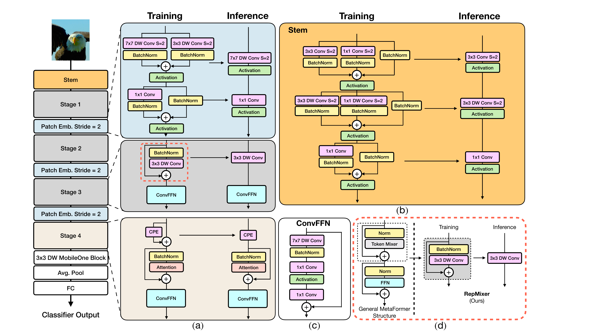
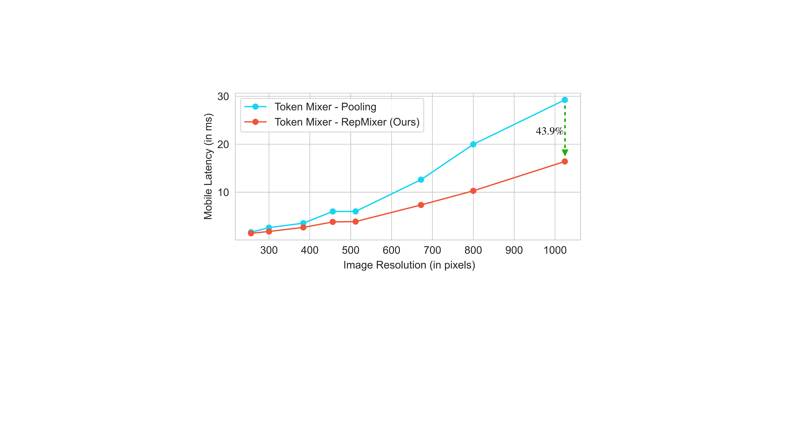
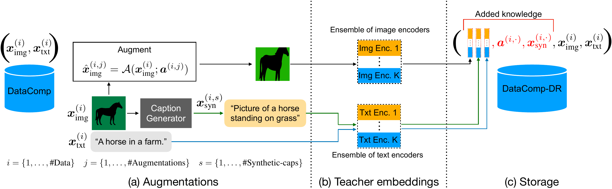

# `FastViTHD` 架构演进与设计逻辑拆解（结合 `FastViT`、`MobileCLIP` 与官方源码）

本文档汇总了 `FastVLM`（[`FastVLM_2412.13303.pdf`](../paper/FastVLM_2412.13303.pdf)）及其两篇直接前作 **`FastViT`**（[`FastViT_2303.14189.pdf`](../paper/FastViT_2303.14189.pdf), ICCV 2023）、**`MobileCLIP`**（[`MobileCLIP_2311.17049.pdf`](../paper/MobileCLIP_2311.17049.pdf), CVPR 2024）以及官方开源代码（`apple/ml-fastvlm` 中的 `mci.py`）中的核心架构推导与消融实验，完整还原从基础算子到 5 阶段 `FastViTHD` 的演进链条。

---

## 1. 四代架构的参数与结构演进总表

在 `FastVLM` 论文中出现的四个关键混合骨干变体，实际上对应了从分类模型 $\rightarrow$ 轻量级 CLIP $\rightarrow$ 高分辨率 VLM 的三次结构演进：

| 架构属性 | **FastViT-MA36** (ICCV 2023) | **MobileCLIP-MCi2** (CVPR 2024，即 FastVLM 文中的 "FastViT") | **FastViT-Naive Scaling** (FastVLM 附录 B.1 对照基线) | **FastViTHD** (FastVLM 本文提出) |
| :--- | :---: | :---: | :---: | :---: |
| **设计目标场景** | $256^2 / 384^2$ 图像分类与检测 | $256^2$ 端侧图文对齐 (CLIP) | 尝试将 4 阶段混合架构直接放大用于高分 VLM | **$512^2 \sim 2048^2$ 高分辨率 VLM** |
| **阶段数 (Stages)** | 4 阶段 | 4 阶段 | 4 阶段 | **5 阶段** |
| **总空间下采样率** | $32\times$ | $32\times$ | $32\times$ | **$64\times$** |
| **$1024^2$ 下输出 Token 数** | 1024 | 1024 | 1024 | **256**（减少 $4\times$） |
| **各阶段算子类型** | `[RM, RM, RM, MHSA]` | `[RM, RM, RM, MHSA]` | `[RM, RM, RM/MHSA, MHSA]` | **`[RM, RM, RM, MHSA, MHSA]`** |
| **各阶段块数 (Depth)** | `[6, 6, 18, 6]` (共 36 层) | `[4, 12, 24, 4]` (共 44 层) | `[2, 12, 16, 6]` (共 36 层) | **`[2, 12, 24, 4, 2]`** (共 44 层) |
| **各阶段通道维度 ($C_i$)** | `[76, 152, 304, 608]` | `[80, 160, 320, 640]` | `[128, 256, 512, 1024]` | **`[96, 192, 384, 768, 1536]`** |
| **ConvFFN 扩展比** | 4.0 | **3.0**（削减 MLP 冗余以加深层数） | 3.0 | **4.0**（恢复高维语义容量） |
| **下采样层 SE 模块** | 无 | **有**（含 Squeeze-and-Excitation） | **有** | **无**（移除高分延迟瓶颈 SE） |
| **自注意力所在空间尺度** | $\frac{R}{32} \times \frac{R}{32}$ | $\frac{R}{32} \times \frac{R}{32}$ | $\frac{R}{16} \times \frac{R}{16}$ 与 $\frac{R}{32} \times \frac{R}{32}$ | **$\frac{R}{32} \times \frac{R}{32}$ 与 $\frac{R}{64} \times \frac{R}{64}$** |
| **总参数量 (Params)** | 42.7M | 35.7M | ~125M | **125.1M** |

---

## 2. 算子层设计原理（源自 `FastViT` ICCV 2023）：Figure 2 内部积木是怎么来的？

`FastVLM` 的 Figure 2 只画出了宏观阶段框图，而每个框内部的微观结构（训练态 vs. 推理态重参数化折叠）实际上在 `FastViT` 原文 Fig. 2 中有完整展示：

> **上图（`FastViT` 论文 Fig. 2）**：这就是 `FastVLM` Figure 2 省略掉的内部微观结构图：
> - **(a) 左侧**：层级化阶段流水线与三个核心模块的训练态/推理态等价转换（顶部蓝框：`Patch Emb. Stride=2`；中部灰框：`RepMixer Block`；底部米色框：`Attention Block` + 条件位置编码 `CPE`）。
> - **(b) 右上橙框**：`Convolutional Stem` 的训练态多分支结构与推理态单路融合。
> - **(c) 中下白框**：前置 $7\times 7$ 深度卷积的 `ConvFFN` 结构。
> - **(d) 右下红虚线框**：从通用 MetaFormer 残差结构演进为无残差跳连的 `RepMixer`。

### 2.1 问题一：为什么浅层高分辨率特征图要用 `RepMixer` 替代普通残差块？（解决显存带宽 MAC 瓶颈）

1. **硬件瓶颈诊断**：
   - 在通用 MetaFormer 结构（上图 (d) 左侧）中，Token Mixing 层的标准写法为：
     $$Y = X + \text{TokenMixer}(\text{Norm}(X))$$
   - 即使把高复杂度的自注意力换成近乎零算力的平均池化（`PoolFormer`）或普通深度卷积（`ConvMixer`：$\text{BN}(\sigma(\text{DWConv}(X))) + X$），**残差连接（`+ X`）依然要求硬件把完整的高分辨率输入张量 $X$ 保存在内存中，等待分支计算完成后再重新读出并相加**。
   - 当输入图像分辨率升至 $1024\times 1024$ 时，浅层特征图的张量极大，这种跨分支的张量读写带来的 **内存访问开销（Memory Access Cost, MAC）** 成为端侧推理延迟的主要瓶颈。

2. **`RepMixer` 的结构重参数化推导（`FastViT` Sec. 3.2.1）**：
   - 为了能在推理时彻底消去残差分支，`FastViT` 调整了 `ConvMixer` 的算子顺序并**移除了中间的非线性激活函数 $\sigma$**，使训练态公式变为纯线性组合：
     $$Y_{\text{train}} = \text{DWConv}_{3\times 3}(\text{BN}(X)) + X \quad \text{（源码中实现为 } X + \alpha \cdot (\text{DWConv}(X) - \text{BN}(X))\text{）}$$
   - 由于 BatchNorm、$3\times 3$ 深度卷积和恒等映射（$+X$，可等价写为中心权重为 1、其余为 0 的 $3\times 3$ 單位卷积核 $I_{3\times 3}$）全都是关于 $X$ 的线性算子，在推理导出时可直接利用卷积的线性可加性合并权重与偏置：
     $$W_{\text{infer}} = W_{\text{DWConv+BN}} + I_{3\times 3}, \quad b_{\text{infer}} = b_{\text{DWConv+BN}}$$
     $$Y_{\text{infer}} = \text{DWConv}^*_{3\times 3}(X)$$
   - **推理态效果**：原本的「归一化 + 混合器 + 残差相加」三个步骤在推理时变成**唯一一个 $3\times 3$ 深度卷积算子**，彻底消除了残差分支的内存读写开销。

> **上图（`FastViT` 论文 Fig. 3）**：在完全相同的计算量（$\sim 1.8\text{G FLOPs}$）下，含残差跳连的 `PoolFormer`（蓝线）与推理态消去残差跳连的 `RepMixer`（红线）在不同输入分辨率下的真机延迟对比。**分辨率越高，消除残差访存开销的收益越大**：在 $384\times 384$ 下降低延迟 **25.1%**，而在 **$1024\times 1024$ 高分辨率下直接降低延迟 43.9%**！

---

### 2.2 问题二：浅层只用 $3\times 3$ `RepMixer` 感受野太小怎么办？（大核深度卷积替代浅层自注意力）

1. **自注意力所在阶段的消融（`FastViT` Table 4 & 附录 Table 6）**：
   - 在 4 阶段模型（`FastViT-S12`）上，如果把 4 个阶段的 Token Mixer 依次从 `RepMixer (RM)` 替换为 `Self-Attention (SA)`：
     - `[RM, RM, RM, RM]`（全卷积）：Top-1 = 79.8%，移动端延迟 = **1.4 ms**
     - **`[RM, RM, RM, SA]`（仅最后阶段用自注意力）**：Top-1 = **80.6%**，延迟 = **1.6 ms**（仅增加 0.2 ms！）
     - `[RM, RM, SA, SA]`（第 3、4 阶段用自注意力）：Top-1 = 81.2%，延迟飙升至 **3.7 ms**（慢了 $2.3\times$）
     - `[SA, SA, SA, SA]`（全自注意力）：Top-1 = 82.0%，延迟高达 **11.7 ms**（慢了 $7.3\times$）
   - **结论**：在浅层/中层高分辨率阶段使用自注意力性价比极低，自注意力应当**仅放在空间尺寸最小的最后阶段**。

2. **用 $7\times 7$ 大核深度卷积补偿浅层感受野（`FastViT` Sec. 3.2.3 & 附录 Table 7）**：
   - 为了弥补前 3 个阶段不使用自注意力导致的有效感受野受限，作者在两个位置引入了 **$7\times 7$ 大核深度可分离卷积**：
     1. **每个块的 `ConvFFN` 入口**（见 `fastvit_arch.png` (c)）：在两层 $1\times 1$ 线性层之前加一个 `$7\times 7$ DWConv + BN`（推理时 BN 可直接融合进 $7\times 7$ DWConv 中）；
     2. **阶段间的 `Patch Embed. Stride=2` 下采样层**（见 `fastvit_arch.png` (a) 顶部蓝框）：使用 stride=2 的 $7\times 7$ 深度卷积（训练时并联一个 $3\times 3$ DWConv 分支，推理时重参数化融合为单个 $7\times 7$ DWConv）接 $1\times 1$ 逐点卷积。
   - **为什么选 $7\times 7$ 而不是更大核？（`FastViT` 附录 Table 7 消融）**：
     - $3\times 3$：Top-1 = 78.9%，延迟 1.3 ms
     - $5\times 5$：Top-1 = 79.5%，延迟 1.4 ms
     - **$7\times 7$（最优拐点）**：Top-1 = **79.8%**，延迟 **1.4 ms**
     - $9\times 9 / 11\times 11$：精度停滞在 79.6% / 79.8%，但参数量、FLOPs 与延迟继续上升。

---

### 2.3 问题三：为什么全网络优先用 `BatchNorm` + $1\times 1$ Conv，而不用 `LayerNorm` + `nn.Linear`？

在 `FastViT` Sec. 3.2.3 与附录 B.1（Table 9）中，作者揭示了一个非常关键的工程实现细节：
1. **可融合性**：`BatchNorm` 在推理时是固定尺度的线性变换，可以**零开销融合（Fold）进前序或后序卷积层**中；而 `LayerNorm` 需要在运行时动态计算每个 Token 的均值和方差，无法与卷积核静态融合。
2. **避免高昂的张量内存重排（Reshape / Permute Overhead）**：
   - 卷积算子天然工作在 `[B, C, H, W]`（Channel-first）内存布局下，而 PyTorch 标准 `LayerNorm` 和 `nn.Linear` 要求 `[B, H, W, C]` 或 `[B, N, C]`（Channel-last）布局。
   - 在 `FastViT` 附录 Table 9 中，作者实测发现：原始 `ConvNeXt` 因为频繁在卷积与 `LayerNorm / Linear` 之间做 `permute/reshape`，在移动端上 `ConvNeXt-T / S / B` 的延迟高达 **33.5 ms / 66.4 ms / 89.1 ms**；仅仅把 `LayerNorm` 改为 Channel-first 实现并把 `Linear` 替换为等价的 `$1\times 1$ Conv2d`（消除 reshape），延迟就骤降至 **3.7 ms / 5.4 ms / 8.4 ms**（快了近 $10\times$）！
   - 因此，在 `FastViT` 与 `FastViTHD` 中：
     - 前 3 个阶段全部采用 `BatchNorm2d`（推理时完全融合消失）和 `$1\times 1$ Conv2d`；
     - 即使在第 4、5 自注意力阶段需要 LayerNorm，源码（`mci.py` 第 489 行）也专门手写了直接在 `[B, C, H, W]` 张量第 1 维（Channel 维）上求均值方差的 **`LayerNormChannel`**，彻底避免了不必要的张量转置。

---

### 2.4 从 PoolFormer 到 FastViT 的逐步演进消融表（`FastViT` Table 1）

下表清晰展示了从 `PoolFormer-S12` 基线一步步加入上述设计后，参数量、FLOPs、延迟与精度的变化：

| 架构演进步骤 (`FastViT` Table 1) | 参数量 (M) | FLOPs (G) | 移动端延迟 (ms) $\downarrow$ | ImageNet Top-1 (%) $\uparrow$ |
| :--- | :---: | :---: | :---: | :---: |
| 0. `PoolFormer-S12` 基线 ($224\times 224$) | 11.9 | 1.8 | 1.50 | 77.2 |
| 1. 分辨率提升 ($224 \rightarrow 256$) | 11.9 | 2.4 | 2.25 | 77.6 |
| 2. **将 Pooling 替换为 `RepMixer`**（消除残差跳连访存） | 11.9 | 2.4 | **1.58** ($\downarrow 30\%$) | **78.5** (+0.9%) |
| 3. 将 Stem / PatchEmb 稠密卷积分解为 DWConv + PWConv | 8.7 | 1.7 | **1.26** | 78.0 |
| 4. **加入训练态线性过参数化**（MobileOne 多分支，推理零开销） | 8.7 | 1.7 | **1.26** (不变) | **78.9** (+0.9%) |
| 5. **FFN 引入 $7\times 7$ 大核深度卷积 (`ConvFFN`)** | 8.7 | 1.8 | 1.33 | **79.4** (+0.5%) |
| 6. **Patch Embed 引入 $7\times 7$ 大核深度卷积**（得到 `FastViT-S12`） | **8.8** | **1.8** | **1.40** | **79.8** (+0.4%) |

---

## 3. 从 `FastViT` 到 `MobileCLIP-MCi2` 再到 `FastViTHD` 的阶段演进

### 3.1 第二代：`MobileCLIP-MCi2`（CVPR 2024）的改动
在 `MobileCLIP`（[`MobileCLIP_2311.17049.pdf`](../paper/MobileCLIP_2311.17049.pdf) Sec. 3.2）中，作者将 `FastViT` 用作图文对比学习的视觉编码器，做了两处调整得到 `MCi2`（即 `FastVLM` 第 3.1 节所使用的 35.7M "FastViT"）：
1. **降低 FFN 扩展比、增加网络深度**：发现 FFN 的 $4.0$ 扩展比存在参数冗余，将其降至 **$3.0$**，并将 4 个阶段的深度从 `[6, 6, 18, 6]` 调整为更符合 `MobileOne` 算力配比的 **`[4, 12, 24, 4]`**，通道维度设为 **`[80, 160, 320, 640]`**。这使得 `MCi2` 比 `FastViT-MA36` 参数更少（35.7M vs. 42.7M）、速度快 16.3%，且零样本 CLIP 分类精度提升 +1.1%。
2. **多模态强化预训练（`DataCompDR`）**：利用 CoCa 生成多条合成密集描述（Synthetic Captions），并用强力 CLIP 教师集成模型（两个 ViT-L/14 集成）计算图像与文本蒸馏特征，离线存储在数据集中供学生模型高效蒸馏预训练（见下图 `MobileCLIP` Fig. 2）。`FastVLM` 的 `FastViTHD` 同样沿用了这一预训练框架。

---

### 3.2 第三代：`FastViTHD`（CVPR 2025）针对高分辨率 VLM 的核心重构

当把 `MobileCLIP-MCi2` 迁移到 VLM（输入分辨率需扩展至 $768^2 \sim 2048^2$，且后接数十亿参数的 LLM）时，原有的 4 阶段架构暴露出两大瓶颈，促使作者设计了 5 阶段的 **`FastViTHD`**：

1. **瓶颈 1：4 阶段架构无法高效放大参数规模（`FastViT-Naive` 的失败，见 FastVLM Fig. 3）**
   - 为了提升 VLM 的多模态泛化能力，需要将视觉编码器从 35.7M 放大到 ~125M。
   - 如果维持 4 阶段结构不变，仅加宽通道至 `[128, 256, 512, 1024]`、调整层数为 `[2, 12, 16, 6]`（`FastViT-Naive`），在 $1024\times 1024$ 分辨率下，第 3 阶段（$16\times$ 下采样，$64\times 64 = 4096$ 个 Token）和第 4 阶段（$32\times$ 下采样，$32\times 32 = 1024$ 个 Token）的张量依然过大，导致编码延迟呈指数上升，甚至比 `ConvNeXt-L` 还慢。
2. **瓶颈 2：$32\times$ 下采样输出的视觉 Token 过多，拖慢 LLM Prefill**
   - 4 阶段模型总下采样率为 $32\times$，在 $1024\times 1024$ 下产生 $1024$ 个视觉 Token；在 $1536\times 1536$ 下产生 $2304$ 个视觉 Token，给 LLM 预填充带来沉重负担。
3. **`FastViTHD` 的三项结构改造**：
   - **改造 A（新增第 5 阶段，总下采样 $64\times$，推迟自注意力）**：
     - 保持前 3 个阶段（$4\times, 8\times, 16\times$ 下采样）全部使用纯卷积 **`RepMixer`**（深度 `[2, 12, 24]`，维度 `[96, 192, 384]`）；
     - 将第 4 阶段（$32\times$ 下采样，维度 $768$）设为 **4 层 `MHSA`**；
     - 新增第 4 个 $7\times 7$ 大核下采样层和 **第 5 阶段（$64\times$ 下采样，维度 $1536$，2 层 `MHSA`）**。
     - 这样，最耗时的自注意力仅在 $\frac{R}{32}$ 和 $\frac{R}{64}$ 的极小特征图上计算，且最终输出的视觉 Token 数量直接减少 **$4\times$**（$1024^2$ 下仅 256 个 Token）。
   - **改造 B（恢复 4.0 FFN 扩展比与 1536 超宽末层通道）**：
     - 将 `ConvFFN` 的扩展比从 `MCi2` 的 3.0 恢复为 **4.0**，且第 5 阶段通道宽度达到 **1536**（MLP 隐藏层达 6144 维），确保每个高度浓缩的视觉 Token 具备充足的通道语义容量。
   - **改造 C（移除 Stage 间的 `SE` 模块）**：
     - 去除 `MCi2` 下采样层中的 `Squeeze-and-Excitation` 模块，消除高分辨率特征图全局池化同步带来的硬件推理延迟。
