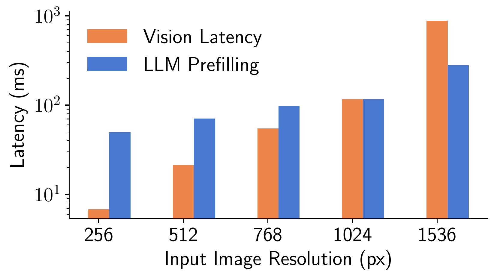
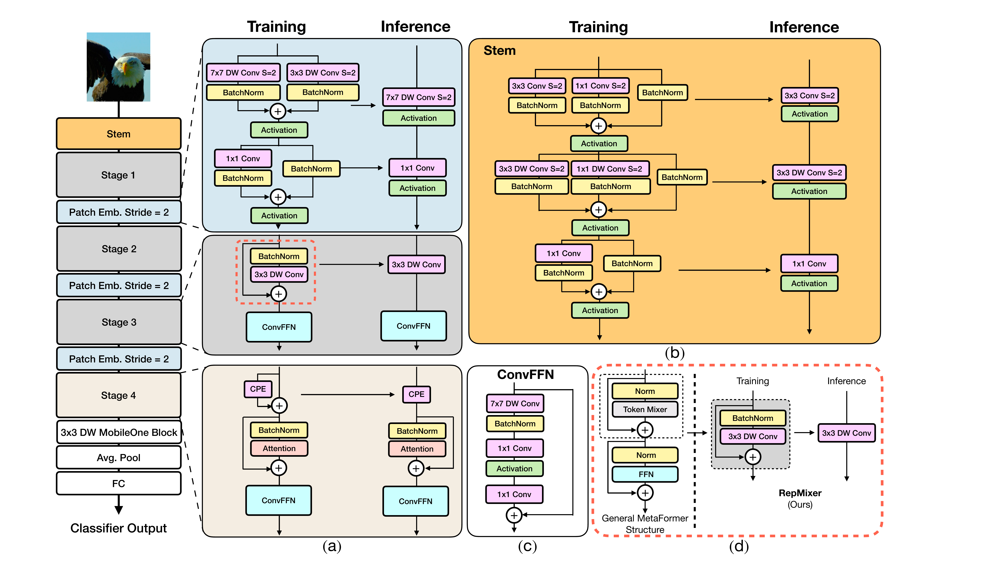
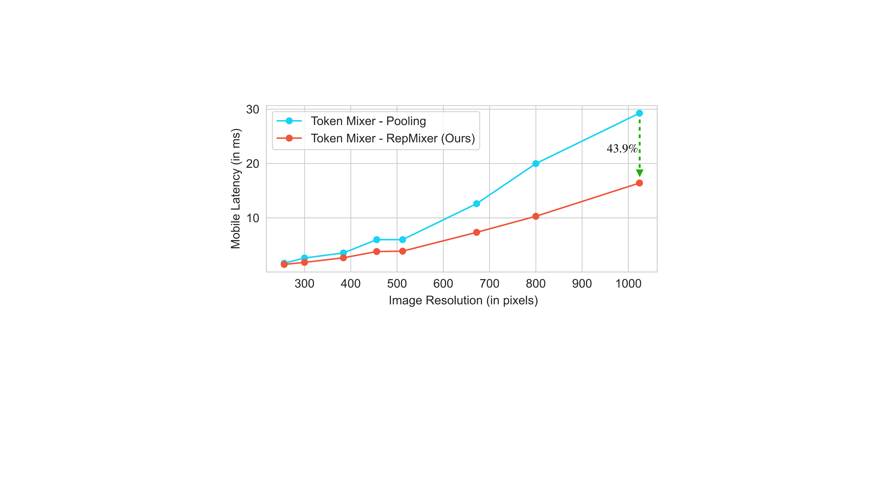
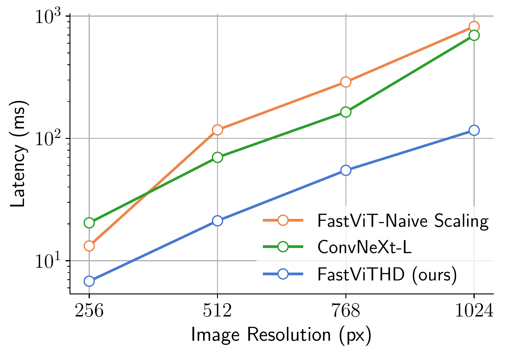
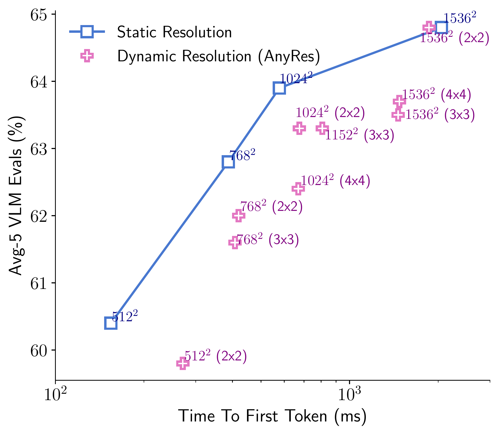
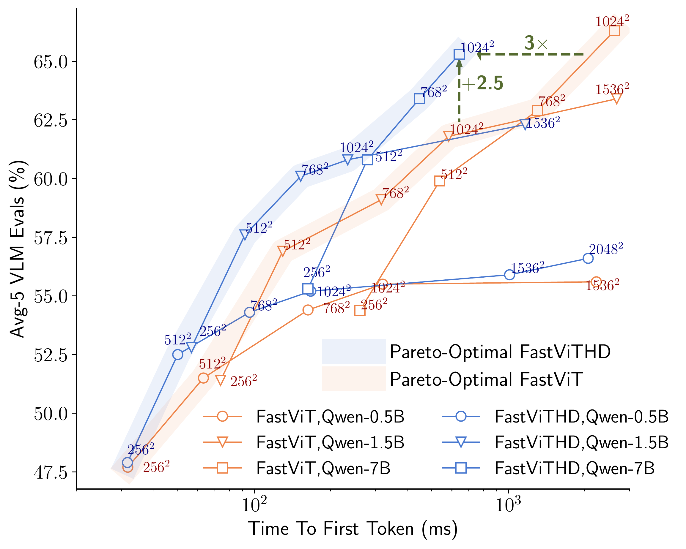

# 文献讲解核心主线（6～7 分钟架构深度剖析与演进脉络）

## 核心主线（One-Sentence Thesis）

> **高分辨率 VLM 的延迟危机，本质是传统各向同性 ViT 同时引发了「编码器内部算力/访存爆炸（$T_{\text{vision}}$）」与「向 LLM 倾倒巨量 Token（$T_{\text{prefill}}$）」；而 FastVLM 的核心思路，不是在 ViT 外部打补丁（切图或剪枝），而是通过「算子级重参数化消访存 $\rightarrow$ 阶段级金字塔下采样 $\rightarrow$ 5 阶段推迟自注意力到 $64\times$」的三步架构演进，从源头重塑高分辨率视觉编码器。**

---

## 第 1 层：把痛点剥开——为什么高分辨率下传统 ViT 和“打补丁”方案全会失效？（约 1.5 分钟）

承接前序关于 VLM 基本范式与 $\text{TTFT} = T_{\text{vision}} + T_{\text{LLM\_prefill}}$ 的介绍，从**架构形态**上剖析高分辨率瓶颈的根源：

1. **传统 ViT 的结构病根（各向同性 Isotropic）**：
   - 图像输入后直接切成 $14\times 14$ 的 Patch，从第 1 层到第 24 层**全程不降采样**。当分辨率升至 $1024\times 1024$ 时，全网每一层都在 $5350$ 个 Token 上计算：
     - **对内（$T_{\text{vision}}$ 爆炸，对应 `FastVLM` Fig. 5）**：浅层网络原本只需提取笔画、边缘等局部特征，却被迫在数千个 Token 上执行 $O(N^2)$ 的全局自注意力。**当分辨率 $\ge 768^2$ 时，视觉编码器自身的耗时反超 LLM Prefill，成为 TTFT 的最大瓶颈。**
     - **对外（$T_{\text{prefill}}$ 爆炸）**：编码结束后将数千个视觉 Token 直接送入数 B 参数的 LLM，导致 LLM 预填充耗时激增。
2. **为什么现有的两种“外部打补丁”思路治标不治本？**
   - **补丁路线 A：后验 Token 剪枝（Token Pruning，如 PruMerge / FastV / VisionZip）**
     - 做法：先让 ViT 跑完并输出数百上千个 Token，进入 LLM 前再按注意力权重丢弃一部分。
     - **结构缺陷**：只减少了 $T_{\text{prefill}}$，**完全没有降低占大头的视觉编码耗时 $T_{\text{vision}}$**；且后验硬丢弃 Token 必然损失细粒度空间信息（见 `FastVLM` Table 5）。
   - **补丁路线 B：动态切图（AnyRes Tiling，如 LLaVA-NeXT / LLaVA-OneVision）**
     - 做法：将高分辨率大图切分为多个 $336\times 336$ 子图分别送入 ViT。
     - **结构缺陷**：多次编码推理 + 数千个 Token（如 LLaVA-OneVision 在 $1152^2$ 下产生 7290 个 Token，端侧 TTFT 高达 14.1 秒），且切图边界人为割裂了跨区域的图表/文本连续语义（Semantic Breaks）。

> **核心问题引出**：与其在 ViT 外部切图、剪枝，能否从**视觉编码器内部架构**入手，设计一个**在高分辨率下自身编码极快、且原生只输出极少量高质量 Token** 的骨干网络？

---

## 第 2 层：架构演进一（算子级）—— 浅层高分辨率特征图怎么算才快？（约 2 分钟）

既然浅层高分辨率阶段不适合跑 $O(N^2)$ 的自注意力，直接换成普通的卷积或池化残差块（如 ConvNeXt / PoolFormer）是否就足够快？**依然不够快。**

1. **硬件瓶颈诊断：高分辨率浅层的真正杀手是「访存开销（MAC）」而非算力（FLOPs）**
   - 常规 MetaFormer / ResNet 块形如 $Y = X + \text{Mixer}(\text{Norm}(X))$：
     - **残差跳连（`+ X`）** 要求硬件将庞大的高分辨率张量 $X$ 缓存在显存/片上内存中，等待分支计算完再重新读出做逐元素相加，带来高昂的双倍读写开销；
     - **`LayerNorm` 与 `Linear`** 要求 Channel-last（`[B, H, W, C]`）内存布局，与卷积算子的 Channel-first（`[B, C, H, W]`）冲突，频繁的张量 `reshape/permute` 在端侧会使 ConvNeXt 变慢近 $10\times$（见 `FastViT` 附录 Table 9）。
2. **针对性设计 1：`RepMixer` 结构重参数化（推理时消灭残差跳连与 BN）**
   - **训练态**：移除了 `ConvMixer` 中间的非线性激活函数，将算子重排为纯线性组合：
     $$Y_{\text{train}} = \text{DWConv}_{3\times 3}(\text{BN}(X)) + X$$
     保留残差分支与 BatchNorm 以确保深层网络梯度顺畅。
   - **推理态**：利用卷积的线性可加性，将 `BN`、`$3\times 3$ DWConv` 与恒等映射分支 $+X$ **代数融合为唯一一个 $3\times 3$ 深度卷积算子**：
     $$Y_{\text{infer}} = \text{DWConv}^*_{3\times 3}(X)$$
     推理时彻底消除了残差分支读写和独立归一化层。在相同 1.8G FLOPs 下，仅这一项设计就在 $1024\times 1024$ 分辨率下降低了 **43.9%** 的延迟（`FastViT` Fig. 3）。
3. **针对性设计 2：用 $7\times 7$ 重叠大核深度卷积补偿浅层感受野**
   - 在每个块的 `ConvFFN` 入口以及阶段间的 `Patch Embed (Stride=2)` 下采样层引入 **$7\times 7$ 大核深度卷积**（配可融合的 `BatchNorm`）；
   - 在不引入自注意力的情况下扩大浅层感受野，并在每次 $2\times$ 空间下采样时，通过高度重叠的 $7\times 7$ 窗口将局部细粒度特征（如文字笔画）平滑编码进翻倍的通道维度（$C \rightarrow 2C$）中。

---

## 第 3 层：架构演进二（阶段级）—— 从 4 阶段 `FastViT` 到 5 阶段 `FastViTHD` 的关键一跃（约 2 分钟）

基于上述算子构建的 **4 阶段混合架构 `FastViT / MobileCLIP-MCi2`**（前 3 阶段 `RepMixer` + 第 4 阶段 `MHSA`，总下采样 $32\times$）在 $256^2$ 低分辨率下表现优异。**但当试图将其放大至 125M 参数并应用于 $1024^2$ 高分辨率 VLM 时（即 `FastViT-Naive`），为什么延迟又出现了崩溃？**

1. **4 阶段混合架构在高分辨率下的两个死穴（`FastVLM` Fig. 3 红线）**：
   - **死穴 1（自注意力介入过早）**：传统 4 阶段模型放大规模时（`FastViT-Naive`：深度 `[2, 12, 16, 6]`，维度 `[128, 256, 512, 1024]`），在第 3 阶段（$16\times$ 下采样）和第 4 阶段（$32\times$ 下采样）堆叠自注意力与 `SE` 模块。在 $1024\times 1024$ 输入下，$16\times$ 下采样仍有 $64\times 64 = 4096$ 个位置，导致自注意力耗时指数级飙升，甚至慢于纯卷积的 `ConvNeXt-L`。
   - **死穴 2（$32\times$ 下采样对 LLM 依然不够紧凑）**：$1024\times 1024$ 下仍会向 LLM 输出 $(1024/32)^2 = 1024$ 个 Token，LLM Prefill 负担依然较重。
2. **`FastViTHD` 的三项结构重构（`FastVLM` Fig. 2）**：
   - **重构 1（4 阶段 $\rightarrow$ 5 阶段，总下采样 $64\times$，推迟 `MHSA`）**：
     - 前 3 个阶段（$4\times, 8\times, 16\times$ 下采样）共 `2 + 12 + 24 = 38` 层**全部锁定为纯卷积 `RepMixer`**（维度 `[96, 192, 384]`）；
     - 新增第 4 个 $7\times 7$ 下采样层与 **第 5 阶段**，**仅将多头自注意力（`MHSA`）放在第 4 阶段（$32\times$ 下采样，4 层，768 维）和第 5 阶段（$64\times$ 下采样，2 层，1536 维）**。
     - 在 $1024\times 1024$ 输入下，Stage 5 的自注意力只需处理 $16\times 16 = \mathbf{256}$ 个位置，编码延迟大幅下降（Fig. 3 蓝线），同时喂给 LLM 的视觉 Token 数直接减少 **$4\times$**（相比 ViT-L/14 减少 **$16\sim 20\times$**）。
   - **重构 2（空间换通道，1536 维超宽浓缩表征）**：
     - 虽然空间尺寸下采样了 $64\times$，但通道数逐级翻倍至 **1536 维**（并将 `ConvFFN` 扩展比从 `MCi2` 的 3.0 恢复为 4.0，MLP 隐藏层达 6144 维），利用高维通道容量保证单个浓缩 Token 的语义承载力。
   - **重构 3（移除 `SE` 模块）**：
     - 去掉 `MCi2` 下采样层中的 `Squeeze-and-Excitation` 全局池化同步算子，消除高分辨率特征图上的硬件推理延迟。

---

## 第 4 层：架构决定系统——从底层设计自然导出的两个系统级结论（约 1 分钟，收尾交棒）

当底层视觉编码器从源头同时解决了「自身高分编码延迟 $T_{\text{vision}}$」与「输出 Token 数量 $N_{\text{tokens}}$」后，VLM 系统层面的优化呈现出两个清晰结论：

1. **静态直接缩放优于复杂切图与后验剪枝（`FastVLM` Fig. 6 & Table 5）**：
   - 由于 `FastViTHD` 支持高效的高分辨率整图推理且输出 Token 极少，**直接静态缩放输入图像分辨率（Static Resolution）** 在 $512^2 \sim 1536^2$ 全区间均处于帕累托最优，无需引入破坏语义连续性的 AnyRes 多网格切图，也无需任何外挂 Token 剪枝模块。
2. **视觉分辨率与 LLM 容量的帕累托协同（`FastVLM` Fig. 4）**：
   - 给定端到端延迟预算（TTFT），视觉输入分辨率必须与 LLM 参数规模相匹配（过小的 LLM 无法有效利用超高分辨率提供的视觉信息）；而 `FastViTHD` 在所有 `(Resolution, LLM)` 组合上将帕累托最优前沿全面推向左上角（同精度下实现 $3\times$ 以上的端侧加速）。
